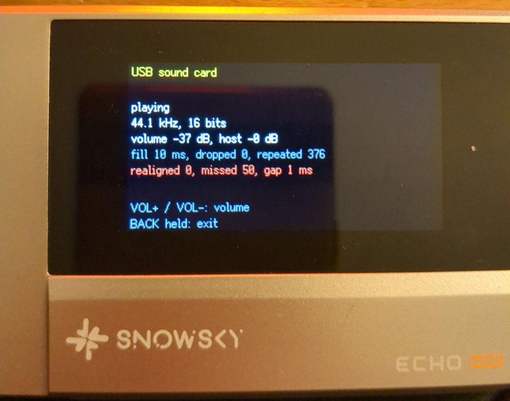
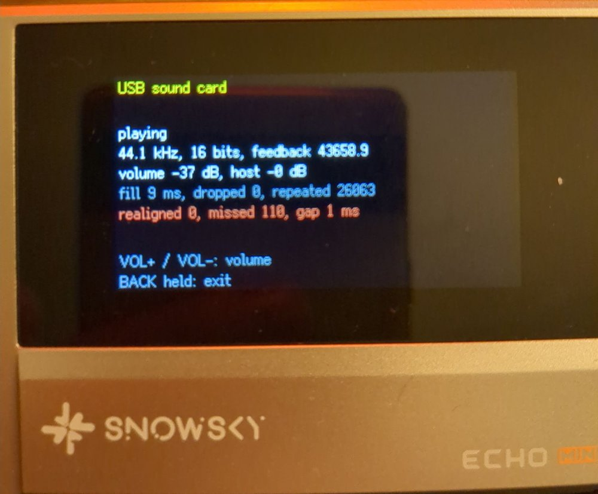

The SNOWSKY ECHO MINI is a small, cheap, Chinese-made, portable music player built around a Rockchip RKNanoD (Two Cortex-M3 SoC) and two Cirrus Logic CS43131 DACs. It’s an astonishing piece of kit because the DACs are far too good compared to the rest of the components.
For the past weeks I have been writing [a new firmware for it from scratch](https://github.com/berettavexee/echo-mini-newfw). Version 0.98, released today, turns the player into a **DAC** or *USB sound card* for the non-audio people. You plug it into a computer or your phone, and the computer's sound comes out of the player's headphone jack, sample for sample. Why? Because the audio circuitry and in particular the protection against electrical interference is "poor" in most consumer electronics. Using a DAC powered by its own battery helps to avoid these disturbances, whether they’re caused by the power supply to your hard drives or a 5,000-watt lighting rig with switch-mode power supplies for sports LED lighting.

What was supposed to be a simple implementation of an existing function – with the help of Claude Code, a bit of documentation, the SDK and other open-source implementations – turned into 22 test images and a journey down the rabbit hole to understand the device’s clock frequency drifts.

## What already existed

Two firmwares already have a "USB DAC" mode, and I studied both before writing a line:

- **The stock firmware** declares a USB Audio Class 1 (UAC1) device: 16 bits, **48 kHz only**, an *adaptive* isochronous endpoint, plus a HID interface so the player's keys act as media keys on the computer. Fine for YouTube, not so much for a FLAC library at 44.1 kHz that the computer has to resample.
- **[EchoPod](https://github.com/BasilSkyWalk/echopod)**, another custom firmware for the same player, does UAC1 at 16 or 24 bits, 44.1 or 48 kHz. Its endpoint is adaptive too, and it handles the drift between the computer's clock and the DACs' clock by dropping or repeating a sample when its buffer drifts too far. Simple and robust, but not bit-perfect.

Both have clocks that can drift; I’d already noticed some strange behaviour in the SoC clock. We’ll come back to that. But that’s what motivated me to implement a clock feedback.

The plan was:
1. UAC1 at full speed, 16 and 24 bits, 44.1 and 48 kHz in synchronous mode;
2. asynchronous mode: the player keeps its own clock and tells the host how many samples to send;
3. UAC2 at high speed, for the higher sample rates.

## A ten-second primer on USB audio

Audio over USB uses **isochronous** transfers: the host sends one packet per frame (every 1 ms at full speed, or every 125 µs "microframe" at high speed), with no retry. A packet that is missed is gone.

The difficulty is the clock. The host sends, say, 44.1 samples per millisecond on *its* clock; the DACs consume them on *theirs*. The two crystals differ by a few tens of ppm, so the buffer between them slowly fills or drains. There are two ways to deal with it:

- **synchronous / adaptive**: the device follows the host's rate (adjusting its own clock, or dropping and repeating samples). The output drifts away from the original signal to make up for the frequency difference, and the clock offset itself is never corrected;
- **asynchronous**: the device keeps its own clock and sends the host a *feedback* value, "send me 44.1017 samples per frame", on a second endpoint. The host adjusts how many samples it puts in each packet. Nothing is ever dropped or repeated: this is what "bit-perfect" means here.

## Step 1: UAC1 at full speed

The USB controller is a Synopsys DWC2, which my firmware already drove for the USB disk mode. I added a generic "class" layer to the driver (descriptors, class requests, an isochronous OUT endpoint), and `uac.c` for the sound card itself: descriptors, the volume and sample-rate requests, and a copy of each packet straight into the DACs' DMA ring. No codec involved, so the second core stays asleep.

The DWC2 has a quirk with isochronous endpoints: each one is armed for an **even or odd frame**, and a packet arriving in a frame of the other parity is silently ignored. So the endpoint must be re-armed for the right parity after each packet, and re-aimed when an "incomplete isochronous OUT" interrupt says a frame went by.

Then the device. **No sound at all**, for five test images. Linux saw a sound card, packets were arriving, the DMA was running. The cause was two GPIOs: starting the USB controller set the pins the way the USB disk mode wants them, and one of them, GPIO2_0, cuts the headphone outputs. In normal playback this never showed, because the audio output is restarted after every USB disk session. The sound card starts the audio first, then the USB, so it had to put the pins back.

Second bug: **high-pitched beeps** whenever the screen changed. At full speed, the endpoint must be re-armed every millisecond, and the main loop was doing it. But drawing one line of text on the screen took 1.4 ms: packets were lost, and each 1 ms hole was filled by repeated samples. The quick fix was to service the USB from inside the drawing routine, between two glyphs.

I played a whole album (29 minutes, 1.7 million packets), not one packet lost during playback, one drift correction every 50 to 60 seconds. About 40 ppm between my PC's clock and the Echo Mini.
After five or six attempts, I now have a sound card that works in 16 and 24-bit modes at 44.1 and 48 kHz in synchronous mode. The clock shift is inaudible. It’s encouraging, and I reckon I’ll have this sorted out soon (I’d been a bit ill and was short of sleep).

*Step 1, synchronous mode at 44.1 kHz: the buffer holds 10 ms of audio, and the "repeated" counter shows the samples repeated to make up for the clock drift.*

## Step 2: asynchronous feedback

The feedback endpoint itself was not difficult. It's an isochronous IN endpoint on a periodic TX FIFO. The format is a bit strange but well documented: a 3-byte value in 10.14 fixed point (samples per frame), sent every frame.

Computing *what* to send was the difficult part. My first idea was to measure the DACs' rate in RX/host frames. The measurements were off by 13 to 33 % and jumped around: the frame number read from the controller skips values. The value sent to the host hit the ±1 % clock adjustment limit, the buffer drained, and the fallback repeated samples at regular intervals (Beeps and static noise).

*The first feedback attempt: 43,658.9 Hz is 44,100 Hz minus exactly 1 %, the limit. The host sent too little, and 26,063 samples had to be repeated.*

What most asynchronous sound cards do is a **control loop on the buffer's fill level**: if the ring holds more than 10 ms of audio, ask for a bit less; if it holds less, ask for a bit more. A proportional-integral controller does it *(as a former automation engineer, I’m very fond of PI control)*. The fill is averaged over about 64 packets. I simulated it in Python for ±40 and +300 ppm before trying it on the device. The integral term ends up holding the clock difference, and the proportional term keeps the buffer on target.

On the device, Linux reported "ASYNC, Feedback Format 10.14", and over 13 minutes of music: **760,727 packets, zero samples dropped or repeated.** The feedback settled at 44,101.7 Hz, which is the same +40 ppm as before, now handled by the host.

There was also a **click when entering the mode**: the USB start-up toggled those two GPIOs again while the DACs were already running. The fix was to let the sound card keep the audio pins, and to always change the volume through a 3 dB / 2 ms ramp.

Yeah, I now have a sound card that works in 16 and 24-bit modes at 44.1 and 48 kHz in asynchronous mode. It’s not that difficult, it’ll all be fine. I’ll be in bed in an hour!

## Step 3a: moving to the USB interrupt

At high speed, a packet can arrive every 125 µs, and no main loop that also draws a screen and polls keys can keep up with that. So before going high speed, the sound card moved to the USB controller's interrupt (IRQ 5 on this chip): the interrupt handler receives packets, writes them to the ring, re-arms endpoints and sends the feedback. The main loop is left with the screen, the keys, the volume and the log. The drawing hacks from step 1 were removed. Same results as step 2, with about 1,900 interrupts per second, 32 µs at most.

This is a direct improvement for UAC1 mode.

## Step 3b: UAC2 at high speed

UAC2 is a different beast from UAC1. There is an interface association descriptor, a *clock source* entity whose sample rate the host sets, `CUR` and `RANGE` requests instead of `GET_MIN`/`GET_MAX`/`GET_RES`, and feedback in 16.16 format, in samples per microframe. I kept UAC1 for full-speed ports and chose the descriptors according to the speed negotiated at enumeration.

Three failed attempts:

- the feedback kept the **old** sample rate after a rate change: the host reads the first feedback packets to guess their format, so the packet already queued had to be replaced at once;
- Linux **ignores** a feedback endpoint that does not answer at every polling interval. So no empty or skipped packets;
- one audio packet **every microframe**, re-armed from the interrupt: one packet in two was missed. Going to a packet every 4 microframes (500 µs) fixed it.

The fourth image (97R) worked: six sample rates from 44.1 to 192 kHz, zero samples dropped or repeated, about 6,000 interrupts per second. 

…in **16 bits**. When I played the same test in 24 bits the next morning, there was no sound at all. Linux showed a perfect feedback rate, but that was only because the device sends the nominal value when it receives nothing. The device's counters said: **zero packets received** in four minutes.

The reason is the controller's receive FIFO. The code was asking for 256 words, but the chip has no dynamic FIFO sizing (one bit in a hardware configuration register says so), so the FIFO stays at **147 words, 588 bytes**, whatever you write. A 16-bit packet at 192 kHz (388 bytes) fits. A 24-bit packet in 4-byte slots (776 bytes) does not, and the controller drops it without any error. I added the value read back from the register to the log, and it said "rx fifo 147 words". It also meant that the "256 words" in my notes from steps 1 and 2 was wrong.

The options were to send a packet every 250 µs (twice the interrupts), 3-byte slots (582 bytes: no room left at all), or stopping at 96 kHz. In UAC2, sample rates belong to the clock, not to the format, so I could not offer 192 kHz in 16 bits only. 
The controller already generates thousands of interrupts per second; it is possible to push it a little further, but the device becomes very unresponsive and even the slightest interaction can cause frame loss. The 24-bit 176.4 and 192 kHz formats are already quite rare, reserved for archiving audio or masters that are to be processed or mixed. Personally, I don’t have any tracks in this format in my library. I’ve decided to limit the sampling rate to 96 kHz.

So the sound card now does **44.1, 48, 88.2 and 96 kHz in 16, 24 or 32 bits**, with packets of 392 bytes at most. Result on the device: 167,708 packets, nothing dropped, repeated or re-aligned.

That’s great – we’re offering twice the sampling rate of the original firmware at 24-bit. Just one more test to go and we can release this feature! 

## The bug the sound card found in the music player

The sound card logs the DACs' real output rate, measured from the DMA's progress over 10 seconds. During the 97R test, when 176.4 kHz was still offered, it said **175,912 Hz**: 0.28 % slow.

The audio PLL settings come from the stock firmware's tables. My file player had been using the same ones since its first versions, so 176.4 kHz *files* had always been played 0.28 % slow, a pitch error about four times smaller than what a trained ear can notice. Nobody can hear that, and a test by ear could not catch it either. The sound card made it visible, because a feedback loop cannot settle on a rate that is not what it claims.

My first fix was wrong: I took one of the four PLL parameters for a fractional part and "doubled" the 44.1 kHz entry. The device played at 175,200 Hz, with horrible beeps. So I went back to the chip's reference manual.
The PLL's oscillator runs at 24 MHz × POSDIV / PREDIV, where POSDIV is an 11-bit number split across two registers (8 high bits in one, 3 low bits in the other). Then an output divider follows, coded rather than direct: the stock tables list the expected output frequency next to each entry, which gives the code-to-divider mapping. Yes, it’s horribly complicated just to set a frequency.

Each table entry has four parameters: POSDIV = 8 × the second + the 3 low bits of the first, PREDIV = the third, and the fourth is the output divider code (3 → ÷5, 8 → ÷9, 9 → ÷3, 10 → ÷6). Downstream, the clock unit divides the PLL output by 5 to make the I2S master clock (MCLK), and the I2S block divides MCLK again to get the bit clock, 64 × the sample rate. With that formula, every entry in the original stock tables gives:

| Parameters | POSDIV / PREDIV | VCO | Output divider | PLL output | MCLK (÷5) | Sample rates (I2S divider) | On the device |
|---|---|---|---|---|---|---|---|
| 3 18 25 3 | 147 / 25 | 141.12 MHz | ÷5 | 28.224 MHz | 5.6448 MHz | 11.025 (÷8), 22.05 kHz (÷4) | no clock at all |
| 0 48 50 8 | 384 / 50 | 184.32 MHz | ÷9 | 20.48 MHz | 4.096 MHz | 8 (÷8), 16 kHz (÷4) | exact |
| 0 24 25 10 | 192 / 25 | 184.32 MHz | ÷6 | 30.72 MHz | 6.144 MHz | 12 (÷8), 24 kHz (÷4) | exact |
| 6 36 25 3 | 294 / 25 | 282.24 MHz | ÷5 | 56.448 MHz | 11.2896 MHz | 44.1 (÷4), 88.2 kHz (÷2) | exact |
| 0 96 50 8 | 768 / 50 | 368.64 MHz | ÷9 | 40.96 MHz | 8.192 MHz | 32 kHz (÷4) | exact |
| 0 48 25 10 | 384 / 25 | 368.64 MHz | ÷6 | 61.44 MHz | 12.288 MHz | 48 kHz (÷4) | exact |
| 0 48 25 9 | 384 / 25 | 368.64 MHz | ÷3 | 122.88 MHz | 24.576 MHz | 96 (÷4), 192 kHz (÷2) | exact |
| **4 73 25 3** | **588 / 25** | **564.48 MHz** | ÷5 | 112.896 MHz | 22.5792 MHz | **176.4 kHz (÷2)** | **0.28 % slow** |
| 0 96 25 8 | 768 / 25 | 737.28 MHz | ÷9 | 81.92 MHz | 16.384 MHz | 64 (÷4), 128 kHz (÷2) | far too slow |

The bad entries are exactly the ones whose oscillator falls outside **184–369 MHz**, the range of every entry that works. The stock parameters are correct on paper; the silicon just does not follow. Months ago I had replaced the 11.025/22.05/64/128 kHz entries with proven PLLs (TRM documentation and SDK) and different clock ratios without knowing why the stock ones failed. The stock firmware drives the PLL outside the range it can hold, and nobody seems to have checked the accuracy of those entries.

The fix for 176.4 kHz is to use the 44.1 kHz PLL (282 MHz) and halve the I2S divider. I also added a permanent measurement of the output rate to the player's log, at each track change. On the player's test folder, **all 15 sample rates from 8 to 192 kHz are now exact**, to the 0.015 % precision of a 7-second track.

The table the firmware uses now has only three oscillator frequencies, all inside the proven range. Rates in bold no longer use their stock entry:

| Parameters | VCO | PLL output | MCLK | Sample rates (I2S divider, MCLK / sample rate) |
|---|---|---|---|---|
| 0 48 50 8 | 184.32 MHz | 20.48 MHz | 4.096 MHz | 8 kHz (÷8, 512 fs), 16 kHz (÷4, 256 fs) |
| 0 24 25 10 | 184.32 MHz | 30.72 MHz | 6.144 MHz | 12 kHz (÷8, 512 fs), 24 kHz (÷4, 256 fs) |
| 6 36 25 3 | 282.24 MHz | 56.448 MHz | 11.2896 MHz | **11.025 kHz (÷16, 1024 fs)**, **22.05 kHz (÷8, 512 fs)**, 44.1 kHz (÷4, 256 fs), 88.2 kHz (÷2, 128 fs), **176.4 kHz (÷1, 64 fs)** |
| 0 96 50 8 | 368.64 MHz | 40.96 MHz | 8.192 MHz | 32 kHz (÷4, 256 fs), **64 kHz (÷2, 128 fs)** |
| 0 48 25 10 | 368.64 MHz | 61.44 MHz | 12.288 MHz | 48 kHz (÷4, 256 fs) |
| 0 48 25 9 | 368.64 MHz | 122.88 MHz | 24.576 MHz | 96 kHz (÷4, 256 fs), **128 kHz (÷3, 192 fs)**, 192 kHz (÷2, 128 fs) |

## One last false alarm

During the final tests I heard a **click at every stream start**. I suspected the ring, the DAC reconfiguration, the volume ramp… The test tones were sine waves that started abruptly, and an abrupt start clicks on any DAC. With a 50 ms fade-in, the clicks were gone. Make your test signals clean before you blame the device.

## How I tested

Everything was tested on a Linux PC first, without PulseAudio or PipeWire in the way:

- `aplay -D hw:3,0 tone.wav` sends the file to the card untouched (no resampling, no mixing);
- `sox -n -r 96000 -b 32 -c 2 tone.wav synth 6 sine 440 vol 0.2 fade t 0.05 6 0.05` makes the tones;
- `/proc/asound/card3/stream0` shows the alternate setting in use, the packet size and, most useful of all, the **feedback rate the host is reading** ("Momentary freq");
- the device itself logs packets received, dropped, repeated and missed, the fill of its ring, the feedback value and the measured output rate, to a text file I read after each session.

The firmware was written mostly by [Claude Code](https://claude.com/claude-code). I did the listening tests on the device; the analysis of each log was done with a bunch of python script.

## Lessons

- **Check what the hardware actually did.** Writing 256 to a register does not give you 256 words, so read the value back and log it.
- **Measure, don't listen.** A 0.28 % error is inaudible and was there from the first version. A rate measurement found it in ten seconds.
- **Don't trust copied parameters.** The 176.4 kHz PLL setting came from the stock firmware and had been carried over, unchanged. Now that LLMs make reverse engineering easier, everyone is pulling the same values from the same binary file without too much checking. 
- **A failure has a range.** Three wrong PLL entries looked like three unrelated bugs; plotted against one number, they were one.
- **When a control loop misbehaves, look at what it controls first.** The beeps of step 2 were not a USB problem, they came from a bad estimate of the DACs' rate.
- **Clean test signals.** Half an hour lost to a click that was in the WAV file.

## Next steps

- Some long listening sessions
- Android and iPhone (and the question of how much current a phone will give)
- A choice screen when the cable is plugged in, 
- HID media keys. 

The full details, in French, are in the project's [study notes](https://github.com/berettavexee/echo-mini-newfw/blob/main/ETUDE.md), sections 83 to 88, and [v0.98 is on GitHub](https://github.com/berettavexee/echo-mini-newfw/releases/tag/v0.98).
