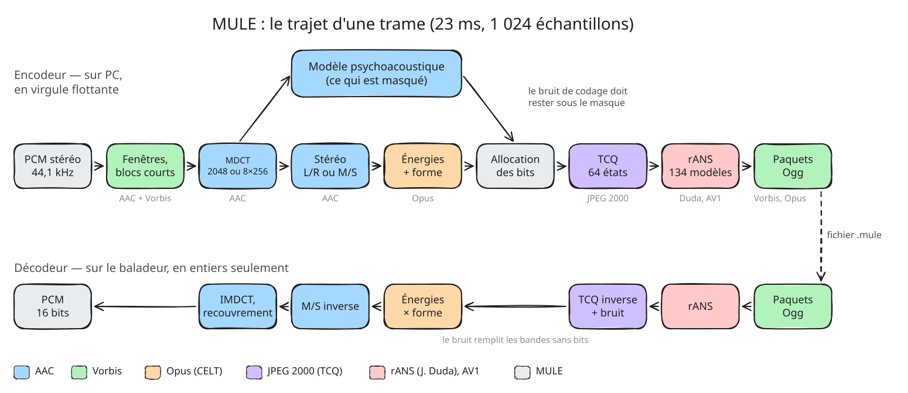
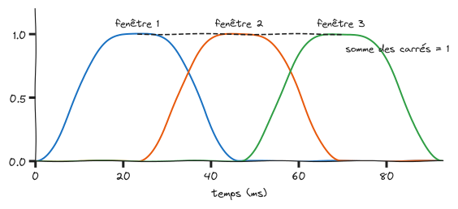
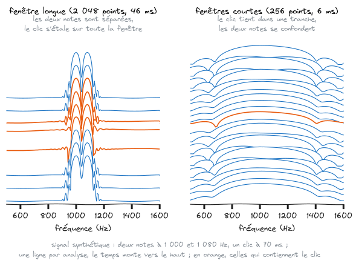
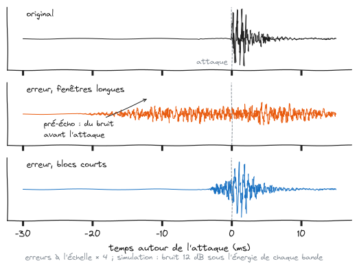
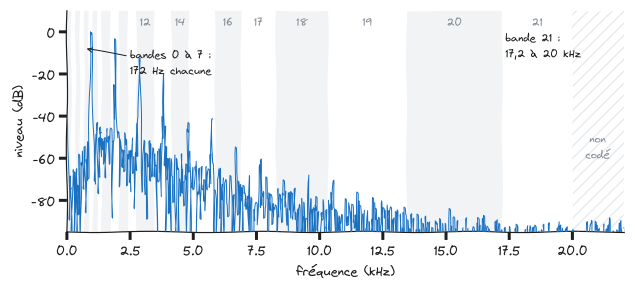
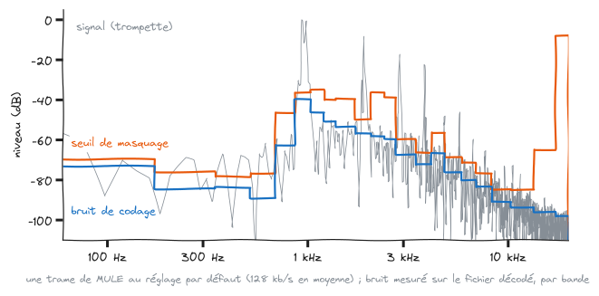
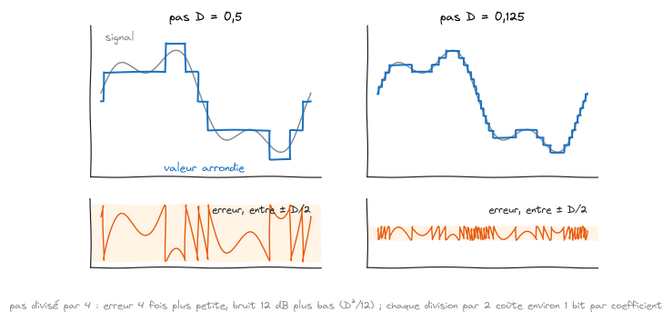
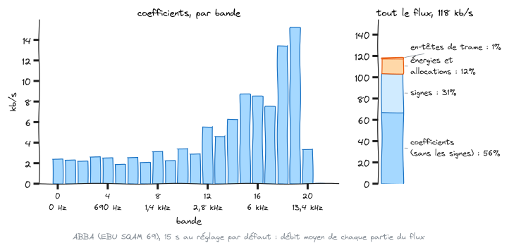
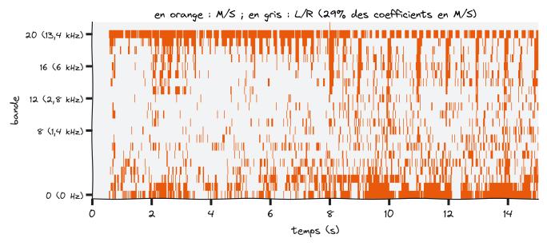
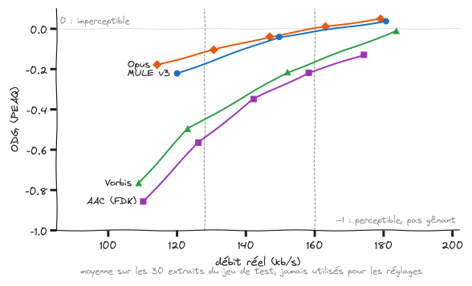

*Premier billet de la série « MULE, ou comment marche un codec audio moderne ».*

## Tout est parti d'un baladeur à trente balles

J'ai porté Ogg [Vorbis](https://fr.wikipedia.org/wiki/Vorbis) et Ogg [Opus](https://en.wikipedia.org/wiki/Opus_%28audio_format%29) sur l'Echo Mini de Snowsky, un petit baladeur audio. Sur le
papier, c'était une formalité : prendre des bibliothèques qui tournent partout depuis quinze
ans, les compiler, câbler l'entrée et la sortie. Dans la vraie vie, je me suis pris deux murs.

Le premier : l'Echo Mini tourne sur un [Cortex-M3](https://fr.wikipedia.org/wiki/ARM_Cortex-M), **sans unité de calcul en [virgule flottante](https://fr.wikipedia.org/wiki/Virgule_flottante)**.
Pas de `float`, ou alors émulé en logiciel, c'est-à-dire à la vitesse d'un escargot.
Le second : le cœur dédié à l'audio, le « cœur B », n'a accès directement qu'à
**très peu de RAM**. 128 Kio pour le code, 148 Kio pour les données. Pour tout. Le décodeur,
ses tables, ses tampons d'entrée et de sortie.

Vorbis, d'abord. Il embarque des [*codebooks*](https://fr.wikipedia.org/wiki/Quantification_vectorielle) (des dictionnaires de quantification envoyés
dans l'en-tête de chaque fichier) et des tables d'IMDCT (la transformée inverse, on y
reviendra) qui prennent tellement de place qu'il faut les étaler sur deux banques de mémoire.
Il ne reste presque rien pour les tampons. Le portage d'origine trichait d'ailleurs avec
l'option de compilation `low_memory` de [Tremor](https://en.wikipedia.org/wiki/Tremor_%28software%29), qui dégradait la qualité de façon audible.

Opus, ensuite. Pas de codebooks, mais la PVQ ([*Pyramid Vector Quantization*](https://en.wikipedia.org/wiki/Pyramid_vector_quantization)), une technique
très astucieuse pour coder de façon compacte des vecteurs de dimension N et de longueur unité.
Je vais être honnête : je n'ai pas compris grand-chose à son fonctionnement. On répartit des
points sur une sphère de dimension N pour représenter un vecteur unitaire. Jusque-là, j'arrive à
suivre. Puis on applique plusieurs fois le même mécanisme (*coordinate-wise power*), ce qui, au
bout d'un moment, crée tout un tas de problèmes : des points répartis de façon pas uniforme, un
écart entre la [distance de Manhattan](https://fr.wikipedia.org/wiki/Distance_de_Manhattan) qu'on emploie et la distance euclidienne qu'on voudrait.
De quoi permettre à plein de gens très brillants d'écrire plein d'articles. C'est clairement
trop compliqué pour moi : je suis trop vieux pour me souvenir de mes cours de géométrie des
[réseaux euclidiens](https://en.wikipedia.org/wiki/Lattice_%28group%29).

Dernier point : comme beaucoup de baladeurs, l'Echo Mini embarque des accélérateurs matériels.
Il fait presque toute la synthèse d'un [MP3](https://fr.wikipedia.org/wiki/MP3) en matériel (on s'en fiche un peu), mais il sait
aussi faire des choses plus lourdes et bien plus intéressantes : des FFT, des FFT inverses et
des IMDCT, pensées pour l'[AAC](https://fr.wikipedia.org/wiki/Advanced_Audio_Coding) et le Vorbis. Sur Tremor, l'implémentation en virgule fixe de
Vorbis, l'IMDCT matérielle va environ quatre fois plus vite que la logicielle. Opus, lui, n'en
profite pas : ses trames de 20 ms font 960 échantillons à 48 kHz, ce qui demande des FFT de
480 points, alors que l'accélérateur ne connaît que les puissances de deux. Tout se fait en
logiciel.

Alors j'ai fait ce que tout développeur raisonnable aurait évité : je me suis lancé dans le
défi un peu idiot d'écrire mon propre codec audio. Avec un cahier des charges court :

- **Une seule mission** : transcoder des CD pour les écouter sur un baladeur. Pas de vidéo à
  48 kHz, pas de visioconférence, pas de pertes de paquets sur le réseau, pas de faible
  latence, pas de 7.1 : rien de tout ce qu'on attend d'un codec moderne généraliste.
- **Un décodeur en virgule fixe**, parce que le matériel n'a pas de FPU.
- **Capable d'utiliser les accélérateurs matériels.**
- **Simple.** Vorbis et Opus ont parfois des conceptions un peu tordues, nées pour contourner
  les brevets logiciels de leur époque. Ces brevets ont expiré : on peut faire simple.
- **Transparent sur une écoute de CD entre 128 et 160 kb/s**, quelque part entre les
  performances de Vorbis et celles d'Opus.

Pour rigoler, je l'ai appelé MULE : c'est un hybride de Vorbis, d'Opus et d'AAC. Comme une
mule, c'est petit, têtu, et ça n'aura pas de descendance.

Dans ce billet, on va suivre **une seule trame** de musique (23 millisecondes de son) depuis le
fichier WAV jusqu'au paquet compressé. Pour chaque étage, trois questions : **de quoi un codec
a-t-il besoin**, **comment les autres s'y prennent** (MP3, AAC, Vorbis, Opus), et **ce que MULE
a choisi, et pourquoi**.

## Le principe : jeter ce qu'on n'entend pas

### Le besoin

Un CD, c'est 1 411 kb/s : 44 100 échantillons par seconde, sur 16 bits, en stéréo. MULE vise
128 kb/s, onze fois moins. Un compresseur sans perte comme [FLAC](https://fr.wikipedia.org/wiki/Free_Lossless_Audio_Codec) tourne entre 600 et 900 kb/s :
il reproduit le signal à l'identique, c'est ce qu'on appelle une compression sans perte. Pour
diviser par onze, il faut éliminer de l'information, beaucoup d'information : c'est la
[compression avec perte](https://en.wikipedia.org/wiki/Lossy_compression). L'astuce consiste à jeter celle que l'oreille n'entendra pas. Ce n'est
pas nouveau : le MP3 le fait depuis plus de trente ans.

Un codec perceptif ne cherche donc pas à reproduire le signal. Il cherche à reproduire **ce
qu'on en perçoit**, avec trois idées :

1. **Passer en fréquences.** L'oreille interne est un analyseur de fréquences. Et supprimer ou
   affaiblir une fréquence directement dans les échantillons PCM, c'est mission impossible ;
   en fréquences, c'est un coefficient à arrondir plus grossièrement.
2. **Déterminer ce qui est masqué.** Un son fort rend inaudibles les sons faibles voisins. Le
   [modèle psychoacoustique](https://fr.wikipedia.org/wiki/Psychoacoustique) calcule, pour chaque morceau du spectre, le niveau sous lequel
   l'oreille ne remarque rien.
3. **Maintenir l'erreur de quantification sous ce masque.** Quantifier, c'est arrondir, donc
   ajouter du bruit. Tout l'art consiste à doser cet arrondi pour que le bruit reste caché sous
   le masque. Là où le masque est haut, j'arrondis plus grossièrement et j'utilise moins de bits.

### Ce que font les autres

Tous les codecs musicaux grand public suivent ce schéma : MP3, AAC, Vorbis, et la partie [CELT](https://fr.wikipedia.org/wiki/CELT)
d'Opus. Opus est en fait un hybride : il a aussi un moteur pour la parole, [SILK](https://en.wikipedia.org/wiki/SILK), qui travaille
dans le domaine temporel par [prédiction linéaire](https://en.wikipedia.org/wiki/Linear_predictive_coding), comme les codecs téléphoniques. Il s'en sert
à bas débit et pour la voix.

### Le choix de MULE

Un codec à transformée pur, sans moteur parole : MULE ne code que de la musique, à des débits où
CELT seul suffit à Opus.

La figure 1 montre la chaîne complète. Les couleurs disent d'où vient chaque brique. Rien n'y
est vraiment inventé : MULE, c'est un assemblage de bonnes idées piquées à droite et à gauche,
plus une ou deux à moi qui ne marchaient pas (j'y reviendrai dans le cinquième billet, qui
s'appellera, sans surprise, « Le cimetière des bonnes idées »).

## Découpage : trames et fenêtres

### Le besoin

Une piste audio ne se code pas d'un bloc. On la découpe en **trames**, et on analyse chaque
trame avec un peu de ses voisines : les analyses se recouvrent. Avant d'analyser, on multiplie
le bloc par une **[fenêtre](https://fr.wikipedia.org/wiki/Fen%C3%AAtrage)** qui monte en douceur puis redescend, plutôt qu'une fenêtre carrée
qui créerait des distorsions aux jonctions.

Reste à choisir la taille, et là, pas de miracle. La théorie du signal le dit : **on ne peut pas
être précis à la fois en temps et en fréquence**. Une fenêtre longue distingue très bien deux
fréquences voisines, ce qui est parfait pour une note de violon tenue. Mais elle étale dans le
temps tout ce qui se passe à l'intérieur.

Prenez une castagnette. Le claquement dure quelques millisecondes ; juste avant, il y a du
silence. Si on code ce bloc en fenêtre longue, le bruit de quantification s'étale sur toute la
fenêtre, y compris sur le silence qui précède l'attaque. Et ce bruit-là, aucun son ne le
masque : on entend un petit souffle *avant* le coup, comme un écho qui serait arrivé en avance.
C'est le **[pré-écho](https://en.wikipedia.org/wiki/Pre-echo)**, le principal défaut des codecs à transformée. Il faut donc pouvoir
**changer de taille de fenêtre** quand une attaque arrive, et un détecteur pour savoir quand.

### Ce que font les autres

- **MP3** : des granules de 576 échantillons, et des blocs courts trois fois plus petits pour
  les attaques. Sa transformée est un hybride bizarre, on en reparle juste après.
- **AAC** : des trames de 1 024 échantillons analysées sur 2 048, et **huit blocs courts de
  256** pour les attaques. Les blocs courts sont **groupés** : ceux qui se ressemblent partagent
  leurs informations, ce qui évite de tout payer huit fois.
- **Vorbis** : deux tailles par fichier, choisies par l'encodeur parmi les puissances de deux de
  64 à 8 192. À 44,1 kHz, libvorbis prend 256 et 2 048, la même géométrie qu'AAC. Sa fenêtre
  est « à puissance complémentaire » : quand on additionne deux fenêtres voisines au carré, on
  retombe exactement sur 1.
- **Opus** : des trames de 2,5 à 20 ms, à 48 kHz seulement, avec un recouvrement très court
  (2,5 ms) pour réduire la latence de la visioconférence. Pour les attaques, il découpe la trame
  en MDCT plus courtes, puis peut rendre de la finesse en fréquence bande par bande. Ses tailles
  ne sont pas des puissances de deux (960 échantillons à 20 ms).

### Le choix de MULE, et pourquoi

**Des trames de 1 024 échantillons (23,2 ms à 44,1 kHz), analysées sur 2 048, et huit blocs
courts de 256 pour les attaques, groupés comme dans AAC. La fenêtre est celle de Vorbis.**

- Pas de contrainte de latence : un baladeur qui lit un fichier se moque d'avoir 23 ms de
  retard. Une grande trame avec un grand recouvrement, c'est la meilleure finesse en fréquence
  pour la musique tenue.
- 44,1 kHz natif : le [DAC](https://fr.wikipedia.org/wiki/Convertisseur_num%C3%A9rique-analogique) de l'Echo Mini tourne à 44,1 kHz, donc pas de rééchantillonnage
  comme avec Opus. *(48 kHz, c'est la fréquence de la vidéo et de la plupart des cartes son ; le
  CD est resté à 44,1)*
- Des puissances de deux : c'est ce que l'accélérateur hardware sait faire pour le AAC.
- Une géométrie éprouvée : AAC et libvorbis tombent sur les mêmes tailles, ce n'est pas un
  hasard.
- Le codec fonctionnant à fréquence fixe (44,1 kHz), on n'a pas besoin de supporter d'autres tailles
  de trames pour les autres fréquences.

Reste à savoir quand basculer en blocs courts. MULE utilise un détecteur de transitoires très
simple : il filtre le signal au-dessus de 3 kHz (en dessous, il n'y a pas vraiment d'attaques
nettes), mesure son énergie par paquets de 128 échantillons, et crie « attaque ! » quand elle
saute de 10 dB. Simple, mais plus efficace que tous les autres systèmes testés.

J'ai passé un temps déraisonnable à essayer d'améliorer ce point (parce que les outils
d'évaluation psychoacoustique pèsent lourdement les attaques) : modulation du bruit, détecteurs
plus malins, plus de bits pour les blocs courts, plus de blocs courts… Presque tout a fini à la
poubelle. Plus de blocs courts, en particulier, fait *baisser* la note. Le système le plus
efficace était le plus simple, une borne héritée d'AAC : le masque d'une trame longue n'a pas
le droit de monter de plus de 10 dB par rapport à la trame précédente.

Et pourquoi pas plus de tailles ? Un bloc intermédiaire de 512 n'a pas été essayé directement,
mais il a été écarté par ricochet : ajouter de la résolution temporelle (plus de blocs courts)
fait baisser la note, et un troisième type de bloc demande des fenêtres de transition en plus.
Des trames de 4 096 ? L'accélérateur ne les prend pas en charge, et elles doubleraient les
tampons du décodeur, sur un cœur B qui compte ses octets. Vorbis les autorise (jusqu'à 8 192),
mais à 44,1 kHz, libvorbis s'en tient à 256 et 2 048.

## Passer en fréquences : la MDCT

### Le besoin

Une transformée qui passe du temps aux fréquences et qui coche quatre cases : des nombres réels
(pas de complexes à stocker), **autant de coefficients que d'échantillons nouveaux** (pas un de
plus à coder), une reconstruction parfaite malgré le recouvrement (pas de clic aux jonctions),
et un calcul rapide.

Il faut aussi regrouper les coefficients en **bandes**, parce que l'oreille ne traite pas les
fréquences une par une. Elle sépare finement deux notes graves, et beaucoup moins finement deux
sifflements aigus. Les acousticiens mesurent ce découpage en **[Bark](https://en.wikipedia.org/wiki/Bark_scale)**, ou [bandes critiques](https://en.wikipedia.org/wiki/Critical_band).

### Ce que font les autres

- **MP3** fait les choses en deux temps : un banc de 32 filtres hérité du MP2, puis une MDCT dans
  chaque sous-bande. C'est un compromis historique (garder la compatibilité avec le MP2), et
  une source connue de défauts.
- **AAC, Vorbis et CELT** utilisent une **MDCT** pure ([*Modified Discrete Cosine Transform*](https://en.wikipedia.org/wiki/Modified_discrete_cosine_transform)).
- Pour les bandes : MP3 a une vingtaine de bandes de facteurs d'échelle, AAC 49 en trame longue
  à 44,1 kHz. Vorbis décrit l'enveloppe du spectre par une courbe en segments (le *floor*).
  CELT utilise 21 bandes calquées sur les Bark.

### Le choix de MULE, et pourquoi

**Une MDCT pure, comme AAC, Vorbis et CELT.** Elle prend 2 048 échantillons et en sort 1 024
coefficients, un par « raie » de fréquence, espacées de 21,5 Hz.

Oui, vous avez bien lu : 2 048 en entrée, 1 024 en sortie. On perd la moitié de l'information
à chaque bloc. Le miracle, c'est que cette perte est rattrapée par le recouvrement : les
erreurs qu'introduit un bloc sont exactement annulées par celles, opposées, du bloc voisin.
Les spécialistes appellent ça le TDAC ([*Time-Domain Aliasing Cancellation*](https://en.wikipedia.org/wiki/Modified_discrete_cosine_transform#Time-domain_aliasing_cancellation)). 

Pourquoi recouvrir à 50 % ? Si on codait des blocs bord à bord, chacun aurait son propre bruit
de quantification, et ce bruit changerait brutalement à chaque jonction : un petit clic toutes
les 23 ms. En recouvrant les blocs de moitié, avec une fenêtre qui monte et descend en douceur,
on passe d'un bloc à l'autre en fondu. Des gens plus malins que moi ont trouvé la condition que
doit remplir la fenêtre pour que la reconstruction reste parfaite (la somme des carrés qui vaut
1, figure 2) : c'est pour ça qu'on n'utilise pas une fenêtre carrée.

Pourquoi pas une bonne vieille FFT ([*Fast Fourier Transform*](https://fr.wikipedia.org/wiki/Transformation_de_Fourier_rapide)) ? Elle donne des nombres
complexes, avec une partie réelle et une partie imaginaire. Avec un recouvrement de moitié, on
coderait deux fois plus de nombres qu'il n'y a d'échantillons. La MDCT recouvre sans rien coder
en double. Bonus pour mon baladeur : une
MDCT se calcule avec une FFT quatre fois plus petite (512 points pour une fenêtre de 2 048), et
cette FFT, l'accélérateur de l'Echo Mini sait la faire.

Le spectre est découpé en **22 bandes** de largeurs inégales : très étroites dans les graves
(8 raies, soit 172 Hz), larges dans les aigus (jusqu'à quelques kHz). C'est proche des 21 bandes
de CELT : à peu près une bande par Bark dans les médiums, et assez peu de bandes pour que leurs
informations (énergie, allocation) coûtent peu.

## Séparer l'énergie de la forme

### Le besoin

Dans chaque bande, il faut transmettre le niveau (combien d'énergie) et le détail (comment cette
énergie se répartit entre les raies). Et l'oreille ne pardonne pas les mêmes choses aux deux. Si
le détail est grossier (les raies un peu à côté de leur vraie valeur), ça passe souvent
inaperçu, surtout dans les aigus. Mais si l'énergie d'une bande est fausse (un trou, une
bosse), ça s'entend tout de suite : le timbre change, le son devient « creux » ou
« métallique ». C'est la même chose pour la compression d'image, si la [teinte est un peu grossière](https://en.wikipedia.org/wiki/Chroma_subsampling)
cela ne se voit presque pas, alors qu'un défaut de luminosité ou de contraste saute aux yeux.

### Ce que font les autres

- **MP3 et AAC** ne codent pas l'énergie. Ils transmettent un **facteur d'échelle** par bande,
  c'est-à-dire un pas de quantification, et l'énergie est ce qui reste après l'arrondi. Une
  bande quantifiée trop grossièrement tombe à zéro, et on entend des trous qui clignotent : les
  fameux « *birdies* » des MP3 à bas débit.
- **Vorbis** code d'abord l'enveloppe (le *floor*), puis le détail divisé par cette enveloppe
  (le *residue*), avec ses codebooks. L'esprit est proche.
- **Opus (CELT)** pousse l'idée au bout : il code **l'énergie** de chaque bande (par pas de
  6 dB, affinés ensuite), puis une **forme** de longueur exactement 1, avec la PVQ. Au décodage,
  forme × énergie donne exactement l'énergie transmise, quelle que soit la précision de la
  forme.

### Le choix de MULE, et pourquoi

**L'énergie à part, comme CELT, mais une forme quantifiée simplement, sans PVQ.** Dans chaque
bande, MULE code :

- **l'énergie** de la bande, par pas de 1,5 dB ;
- **la forme** : les coefficients divisés par cette énergie, puis arrondis avec un pas propre à
  la bande (l'allocation, on y vient).

Le niveau de la bande est donc toujours juste à 1,5 dB près, et l'arrondi de la forme se fait
autour de ce niveau, pas à sa place. Je n'impose pas la longueur 1 comme CELT : c'est ce qui
permet de se passer de la PVQ, que je ne comprenais pas, et d'utiliser un quantificateur
scalaire, bien plus simple (et en treillis, voir plus bas). J'ai quand même codé une PVQ pour
comparer : elle perdait, surtout sur les sons tonals.

Ces énergies coûtent peu, parce qu'elles sont prévisibles : une bande ressemble à la même bande
dans la trame précédente, et à sa voisine du dessous. MULE ne code que l'écart à cette
prédiction. Le troisième billet racontera comment on grappille les bits là-dessus.

> **Encadré : et si une bande n'a droit à aucun bit ?**
>
> Ça arrive : quand une bande est entièrement sous le masque, inutile de coder sa forme. Mais la
> laisser vide créerait un trou dans le spectre, et un trou, ça s'entend.
>
> - **MP3** laisse le trou.
> - **AAC** peut remplacer une bande par du bruit, si l'encodeur le signale (le *PNS*), et ses
>   versions récentes remplissent les zéros de bruit (*noise filling*).
> - **Opus** recopie dans la bande vide un morceau du spectre des bandes plus basses (le
>   *pliage*, ou *folding*), puis le remet au bon niveau.
>
> **MULE** remplit la bande de **bruit**, mis exactement au niveau de l'énergie transmise. Pas de
> pliage : à 128 kb/s, MULE n'a presque besoin de bruit qu'au-dessus de 16 kHz, où le pliage
> n'apporterait rien d'audible. C'est bluffant de voir à quel point l'oreille se contente d'un
> bruit au bon niveau dans les aigus.

## Le masque psychoacoustique

### Le besoin

Depuis le début de l'article on parle de masque sans vraiment expliquer ce que c'est. 
Tout ce qui précède, c'est de la plomberie. Le modèle psychoacoustique, c'est le modèle perceptif. 
Son travail : pour chaque bande de chaque trame, dire **combien de bruit on peut ajouter sans que
personne ne s'en rende compte** ou à quel point on peut **dégrader le signal dans cette zone sans 
que cela ne soit audible**.

Il repose d'abord sur le **[masquage simultané](https://en.wikipedia.org/wiki/Auditory_masking)**. Un son fort rend inaudibles les sons plus
faibles de fréquence voisine. Une grosse caisse noie le petit bruit de fond dans les graves ;
une cymbale cache une foule de détails dans les aigus. Ce masquage déborde de part et d'autre
de la fréquence du son masquant, avec une pente asymétrique : il s'étend plus vers les aigus
que vers les graves.

Ensuite vient la **tonalité**. Un son pur masque *moins bien* qu'un bruit de même énergie :
l'oreille repère facilement un petit bruit parasite à côté d'une flûte, beaucoup moins à côté 
d'une cymbale.

Enfin, il y a le **[seuil absolu d'audition](https://fr.wikipedia.org/wiki/Seuil_absolu_d'audition)** : en dessous d'un certain niveau, on n'entend rien
du tout, masque ou pas.

### Ce que font les autres

- **MP3 et AAC** : la norme décrit deux modèles, dits 1 et 2, mais seulement à titre
  d'exemple : le modèle psychoacoustique n'est pas normatif, chaque encodeur fait ce qu'il veut.
  [LAME](https://fr.wikipedia.org/wiki/LAME), l'encodeur MP3 libre, a le sien, réglé à l'oreille pendant des années.
- **Vorbis** : un modèle dans l'encodeur, avec des courbes de masquage différentes pour les sons
  tonals et pour le bruit.
- **Opus** n'a pas de masque explicite. C'est la conservation de l'énergie par bande, une table
  d'allocation fixe et quelques coups de pouce de l'encodeur qui en tiennent lieu.

### Le choix de MULE, et pourquoi

**Un masque explicite, calculé bande par bande, dans la tradition d'AAC.** Le débordement d'une
bande sur l'autre suit la fonction d'étalement classique de Schroeder, qui date de 1979. Rien de
neuf sous le soleil. La tonalité se mesure par la « [platitude](https://en.wikipedia.org/wiki/Spectral_flatness) » du spectre de chaque bande :
plate, c'est du bruit ; avec un pic net, c'est un son tonal. Selon le cas, le seuil de masquage
est placé 5,5 dB sous l'énergie (bruit) ou bien plus bas, jusqu'à 25 dB (tonal).

Pourquoi un masque explicite plutôt que la méthode d'Opus ? Parce que dans MULE, c'est
l'encodeur qui décide de tout et le décodeur qui obéit. Un masque explicite se règle, se mesure
et s'améliore sans toucher au format. Après le gel du format v2, tous les gains de qualité sont
venus de l'encodeur (masque et allocation), sans changer une ligne du décodeur.

Ça, c'est la théorie savante. Dans la pratique, le modèle a eu besoin de quelques rustines
empiriques, et ce sont elles qui ont fait la différence :

- **+10 dB de marge dans les 8 premières bandes**, sous 1,4 kHz, et un peu de marge dans les
  médiums. Les modèles classiques sont trop optimistes dans les graves.
- **Des masques calculés raie par raie dans les graves**, au lieu d'un masque par bande. En
  dessous de 2 kHz, une seule bande couvre presque 2 Bark, et un masque calculé sur toute la
  bande laissait passer du bruit autour des notes graves isolées. Cette correction-là a rapporté
  jusqu'à **+0,2 point** sur la note de qualité d'un orchestre et d'un extrait de triangles.
  C'est énorme, à l'échelle de ce projet.
- **La borne de pré-écho** empruntée à AAC et évoquée plus haut.

La figure 6 résume tout le billet. Si vous ne deviez en retenir qu'une phrase, ce serait
celle-ci : **l'encodeur ne cherche pas à reproduire le signal, il cherche à cacher son
erreur.** Le bruit de codage est là, partout, mais il épouse la forme du masque, toujours un peu
en dessous.

J'ai évidemment essayé de faire mieux : le modèle 2 de MPEG (qui mesure la tonalité autrement),
l'étalement de Terhardt, l'addition des masques en loi de puissance, et récemment le masquage
temporel. Tout a fini au cimetière, et le cinquième billet racontera pourquoi. Le modèle actuel
n'a rien de révolutionnaire. Il est juste bien réglé.

## Distribuer les bits : l'allocation

### Le besoin

Le masque dit combien de bruit chaque bande peut supporter. Reste à traduire ça en bits. Le
bruit de quantification dépend du **pas** : si on arrondit au multiple de D le plus proche,
l'erreur moyenne vaut à peu près D²/12. Il faut donc choisir un pas par bande, et décider
comment le budget se répartit d'une trame à l'autre.

### Ce que font les autres

- **MP3 et AAC** cherchent les pas par une double boucle : une boucle sur le gain global pour
  tenir le débit, une boucle sur les facteurs d'échelle pour repousser le bruit sous le masque.
  Ils visent souvent un débit constant, lissé par un « réservoir de bits ».
- **Vorbis** travaille surtout en qualité constante (le `-q` d'oggenc), le débit suit.
- **Opus** a une approche originale : **l'allocation n'est pas transmise**. Le décodeur la
  recalcule lui-même à partir du budget de la trame et d'une table fixe ; l'encodeur n'envoie
  que quelques ajustements. Peu d'informations à transmettre, mais moins de liberté pour
  l'encodeur.

### Le choix de MULE, et pourquoi

**Une allocation explicite par bande, tirée du masque, puis ajustée en comptant les vrais
bits ; et un débit variable à qualité constante.**

Pour chaque bande, MULE choisit le pas qui met le bruit exactement au niveau du masque,
multiplié par un réglage global de qualité. Ce pas est transmis sous forme d'« allocation », un
entier : une unité de plus, c'est un pas plus fin de 1,5 dB, donc un peu plus de précision et un
peu plus de bits. Le coût est faible, parce que l'allocation d'une bande ressemble à celle de sa
voisine ou de la trame précédente. En échange, l'encodeur est libre : c'est lui qui décide, et
il peut progresser sans toucher au décodeur. *Si vous ne l'avez pas encore compris, porter le
décodeur pour l'Echo Mini, mettre à jour le firmware et effectuer les tests est excessivement
répétitif et fatiguant. Mettre à jour et tester des évolutions de l'encodeur peut être fait de
manière très automatisée avec Python et Claude Code.*

Ensuite vient la quantification proprement dite. MULE n'arrondit pas bêtement chaque
coefficient : il utilise une **quantification en treillis** (TCQ), une technique empruntée à
[JPEG 2000](https://fr.wikipedia.org/wiki/JPEG_2000) qui divise le pas par deux sans payer le bit supplémentaire. C'est le gain le plus
important du projet, et ça mérite un billet entier, le deuxième. Pour l'instant, retenez juste
qu'elle existe et qu'elle est géniale.

Le calcul « pas idéal = masque » est un point de départ, pas une vérité. Parfois, une allocation
d'une unité plus faible coûte beaucoup moins de bits pour un bruit à peine plus fort ; parfois,
c'est l'inverse. L'encodeur essaie donc, pour chaque bande, l'allocation calculée et ses deux
voisines, et garde celle qui minimise « bruit + λ × bits ». C'est le compromis
**[débit-distorsion](https://en.wikipedia.org/wiki/Rate%E2%80%93distortion_theory)**, la même idée que dans les encodeurs vidéo. λ dit combien un bit vaut en
bruit. Et MULE compte les **vrais** bits, avec les mêmes modèles de probabilité que le codeur
entropique qui viendra juste après.

Dernière chose : MULE est un codec **[à débit variable](https://en.wikipedia.org/wiki/Variable_bitrate)**. Chaque trame vise la même qualité
perçue, c'est-à-dire le même rapport entre bruit et masque, et prend les bits dont elle a besoin.
Un passage calme coûte peu, une batterie saturée coûte cher. Le réservoir de bits d'AAC n'a pas
de sens ici : on encode un fichier, personne n'attend un débit constant. J'ai testé des
stratégies plus complexes : plus de bits aux attaques, ou aux trames les plus « difficiles ».
Rien ne fait mieux que cette règle simple. 

C'était prévu théoriquement et c'est le mode de fonctionnement de Vorbis; je l'ai vérifié 
quand même, parce que je suis têtu. Comme une mule *(et parce que c'est Claude qui a fait le 
boulot)*.

## La stéréo : deux canaux pour le prix d'un et demi

### Le besoin

La gauche et la droite d'un morceau se ressemblent énormément : la voix est au milieu, la
basse aussi, souvent la batterie. Coder les deux canaux séparément, c'est payer deux fois la
même information.

### Ce que font les autres

La parade classique est le codage **[M/S](https://en.wikipedia.org/wiki/Joint_encoding)** : au lieu de gauche et droite, on code le **milieu**
(M, la somme) et le **côté** (S, la différence). Quand les deux canaux se ressemblent, S est
presque nul et ne coûte presque rien.

- **MP3** choisit L/R ou M/S pour toute la trame.
- **AAC** choisit bande par bande.
- **Vorbis** utilise un couplage « polaire » sans perte, et à bas débit une stéréo simplifiée
  dans les aigus.
- **Opus** code M et S avec un angle par bande qui règle leur part respective.

Pour les bas débits, AAC et Opus ont aussi la **[stéréo d'intensité](https://en.wikipedia.org/wiki/Joint_encoding#Intensity_stereo)** : dans les aigus, on ne
code qu'un canal et un angle, et le décodeur reconstruit la stéréo.

### Le choix de MULE, et pourquoi

**L/R ou M/S, bande par bande et trame par trame, comme AAC.** Pour chaque bande, l'encodeur
estime ce que coûteraient les deux représentations, en « entropie perceptuelle » (grossièrement,
le nombre de bits qu'il faudrait pour rester sous le masque), et prend la moins chère. Sur mon
corpus de réglage, environ 41 % des coefficients finissent en M/S.

Pas d'intensité : je l'ai évaluée pour MULE, et à 128 kb/s elle rapporterait au mieux 2 à 3 %
de débit, au prix d'une image stéréo dégradée. Opus lui-même la réserve aux bas débits. Pas
d'angle à la Opus non plus : une rotation par bande, mesurée, rapportait 0,16 % de débit.
L'angle d'Opus découle de sa construction énergie/forme : comme M et S ont chacun une forme de
longueur 1, il faut bien dire comment l'énergie se partage entre eux.

## Mettre en boîte : codage entropique et conteneur

### Le besoin

À ce stade, la trame est devenue une suite de petits nombres : le type de bloc, les choix
stéréo, les énergies, les allocations, les coefficients quantifiés et leurs signes. Il reste à
les écrire avec le moins de bits possible : c'est le travail du **[codeur entropique](https://fr.wikipedia.org/wiki/Codage_entropique)**. Un symbole
fréquent doit coûter une fraction de bit ; un symbole rare en coûte plusieurs. Puis il faut
ranger les trames dans un fichier, et pouvoir sauter n'importe où dedans.

### Ce que font les autres

- **MP3 et AAC** : des tables de [Huffman](https://fr.wikipedia.org/wiki/Codage_de_Huffman) fixes, gravées dans la norme.
- **Vorbis** : du Huffman aussi, mais les tables (les codebooks) sont dans l'en-tête de chaque
  fichier. Souple, mais il faut les charger en RAM.
- **Opus** : un [codeur arithmétique](https://fr.wikipedia.org/wiki/Codage_arithm%C3%A9tique) ([*range coder*](https://en.wikipedia.org/wiki/Range_coding)), avec des probabilités fixes.
- **[AV1](https://fr.wikipedia.org/wiki/AV1)**, le codec vidéo, utilise un codeur arithmétique dont les probabilités **s'adaptent**
  au fil du flux.
- Côté conteneur, le MP3 aligne ses trames à la suite, AAC vit dans du MP4 (ou de l'ADTS), Vorbis
  et Opus dans de l'Ogg.

Pour Vorbis, en théorie, l'encodeur pourrait générer des tables de Huffman propres à chaque piste.
Dans les faits, chaque encodeur réutilise un jeu de tables prédéfini en fonction des paramètres.
Toutes les pistes d'un même album utilisent les mêmes tables. L'intérêt de mettre les tables
dans le fichier, c'est qu'on peut changer l'encodeur sans toucher au décodeur.

### Le choix de MULE, et pourquoi

**Un codeur rANS** (une variante de l'[*Asymmetric Numeral System*](https://en.wikipedia.org/wiki/Asymmetric_numeral_systems) de Jarek Duda) **et
134 modèles de probabilité qui s'adaptent au fil du morceau, à la manière d'AV1.** Les tables
de départ sont apprises sur un corpus et tiennent dans le décodeur : rien à charger par fichier,
contrairement à Vorbis. Le décodeur rANS se réduit à quelques multiplications et décalages
entiers, ce qui convient parfaitement à un Cortex-M3. C'est là que se gagne une énorme partie
de la compression : sans codeur entropique, le même flux pèserait plus du double. Le troisième
billet lui sera consacré.

Les trames sont groupées par **paquets de 4**. Toutes les 40 trames (0,93 s), un **paquet clé**
remet les modèles de probabilité à zéro : c'est ce qui permet de sauter n'importe où dans un
morceau sans tout décoder depuis le début. Les paquets sont rangés dans un conteneur **[Ogg](https://fr.wikipedia.org/wiki/Ogg)**,
exactement comme Vorbis et Opus. Le lecteur de l'Echo Mini et la plupart des firmwares alternatifs
savent lire les conteneurs Ogg, et Ogg apporte gratuitement les métadonnées et la
**[lecture sans blanc](https://en.wikipedia.org/wiki/Gapless_playback)** entre les pistes d'un album live. Merci Xiph.

## Le décodeur, en miroir

### Le besoin

Le décodeur doit refaire, dans l'ordre inverse, tout ce que l'encodeur a écrit : lire les
symboles, reconstruire les coefficients, défaire la stéréo, revenir dans le domaine temporel
et recoller les fenêtres. Il doit être petit, rapide, et surtout donner partout le même son.

### Ce que font les autres

Ce que dit la norme, et ce que tolère la conformité, varie beaucoup :

- **MP3 et AAC** acceptent une petite erreur par rapport au décodeur de référence.
- **Opus** fournit une version en virgule fixe officielle, et vérifie la conformité avec un
  seuil de qualité, pas au bit près.
- **Tremor**, l'implémentation officielle de Vorbis en virgule fixe ne sort pas les mêmes échantillons que libvorbis.

C'est super casse-pieds quand vous devez évaluer la qualité d'un décodeur au hasard parce que vous 
devez le porter sur un lecteur de musique portable qui comporte des accélérateurs matériels pas super
bien documentés et qui font des arrondis en interne.

### Le choix de MULE, et pourquoi

**Un décodeur virgule fixe uniquement, dont la sortie est normative au bit près.** Il ne réfléchit
pas : il lit. Pas de modèle psychoacoustique, aucune décision à prendre. Il décode les symboles,
reconstruit les coefficients (en remplissant de bruit les bandes sans bits), défait le M/S,
applique la MDCT inverse et recolle les fenêtres.

D'où une asymétrie énorme. L'encodeur, en virgule flottante, avec son [Viterbi](https://fr.wikipedia.org/wiki/Algorithme_de_Viterbi) et ses
allers-retours débit-distorsion, tourne quatre à six fois plus vite que le temps réel sur un
PC. Le décodeur tourne sur le baladeur à environ **59 MHz** en moyenne, dans 30 Kio de code et
de tables, **sans jamais toucher un nombre à virgule flottante**. Tout est en entiers, et la sortie est
identique au bit près sur le PC, dans l'émulateur du firmware et sur le Cortex-M3. Une seule
version du décodeur à tester, et un test qui se résume à comparer deux fichiers. Ce n'était pas
évident dès le départ mais cela s'est imposé très rapidement pour ne pas devenir fou.

## Alors, ça vaut quoi ?

Évidemment, la vraie question : est-ce que ça marche ? Voici MULE face aux trois codecs qu'il
pille allègrement, sur 30 extraits tirés au hasard de ma bibliothèque et jamais utilisés pour les réglages,
à débit égal. L'ODG est la note de [PEAQ](https://en.wikipedia.org/wiki/Perceptual_Evaluation_of_Audio_Quality), un modèle d'écoute normalisé : 0, on n'entend pas de
différence avec l'original ; −1, c'est audible mais pas gênant. ViSQOL note de 1 à 5.

| | ODG à 128 kb/s | ODG à 160 kb/s | ODG avancé, 128 / 160 | ViSQOL à 128 kb/s |
|---|---|---|---|---|
| AAC (FDK) | −0,54 | −0,21 | −0,57 / −0,27 | 4,30 |
| Vorbis | −0,45 | −0,16 | −0,63 / −0,34 | 4,47 |
| Opus | **−0,12** | **0,00** | −0,45 / −0,24 | 4,54 |
| MULE | −0,17 | −0,01 | **−0,36 / −0,14** | **4,61** |

L'AAC vient de [FDK-AAC](https://en.wikipedia.org/wiki/Fraunhofer_FDK_AAC), l'encodeur de Fraunhofer (celui d'Android), en AAC-LC à débit constant et réglages par défaut. Sa dernière place est en partie un choix : il coupe tout au-dessus de
16 kHz environ, quand les trois autres montent à 20 kHz. Il met ses bits là où l'oreille d'un adulte les entend vraiment, et PEAQ et ViSQOL le lui font payer sans doute plus cher que vos
oreilles. L'encodeur AAC d'Apple, réputé meilleur, ne tourne que sous Windows et macOS *(flemme de faire tourner dans wine)*.

Soyons honnêtes : Opus reste devant sur la note de base de PEAQ. MULE passe devant sur la
version avancée de PEAQ et sur ViSQOL, et il enterre Vorbis et FDK-AAC partout. Mais regardez les
écarts : on se bat pour des centièmes, dans la zone où PEAQ lui-même dit « imperceptible ». Et
en [écoute à l'aveugle](https://fr.wikipedia.org/wiki/Test_ABX) (16 essais par extrait, sur les six extraits où PEAQ voyait le plus grand
écart), je n'ai su distinguer MULE à 128 kb/s ni de l'original, ni d'Opus. Mes oreilles sont
probablement nulles. C'est une hypothèse sérieuse, et j'y reviendrai dans un autre billet.
Mais même les aficionados de [Hydrogenaudio](https://en.wikipedia.org/wiki/Hydrogenaudio), sont mis en difficulté sur les tests ABX de codec
moderne comme Opus, Vorbis et AAC.

On triche : MULE ne fonctionne qu'à 44,1 kHz et en 16 bits, parce que c'est le format du CD.
Cela réduit drastiquement le nombre de paramètres à optimiser. Le code a aussi beaucoup moins
de fonctions que les autres, qui savent faire du multicanal, de la faible latence, résister aux
pertes de paquets, etc. Nous, on s'est limité à la lecture sur un baladeur.

La morale de l'histoire, c'est qu'un codec audio est constitué d'un certain nombre de briques.
Ces briques ont toutes une fonction et une raison d'être. Certaines sont relativement simples,
comme la MDCT, quasi identique dans de nombreux codecs ; d'autres relèvent de la magie noire et
des horreurs cosmiques du mythe de Cthulhu, comme la PVQ d'Opus.

Les choix de MULE ne sont pas meilleurs que ceux d'Opus : ils sont faits pour
un seul usage, sans les contraintes de latence, de réseau ou de brevets qu'Opus devait
respecter. Le génie d'Opus ou d'AAC n'est pas dans une idée géniale cachée, il est dans dix ans
de réglages, de mesures et d'écoutes. Si vous voulez un bon codec : **utilisez Opus**. Si vous
voulez comprendre comment fonctionne un codec, en concevoir un vous-même, même mauvais, est une
excellente école.

Au prochain épisode : la quantification en treillis.
