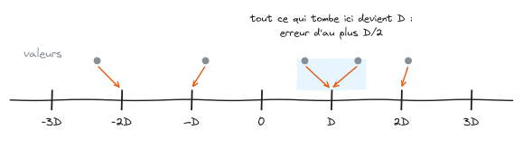
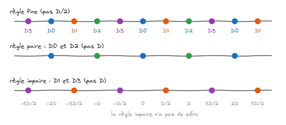
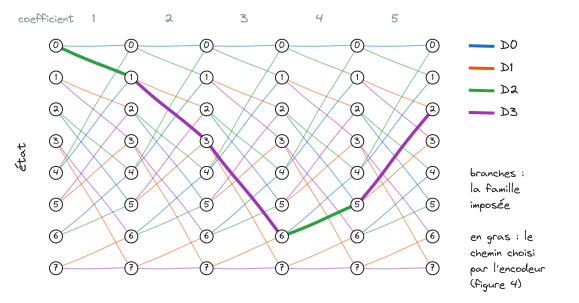
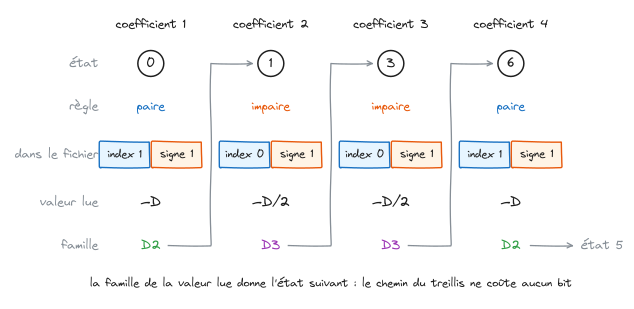
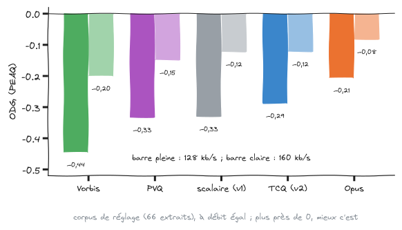
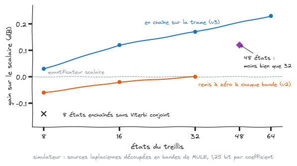
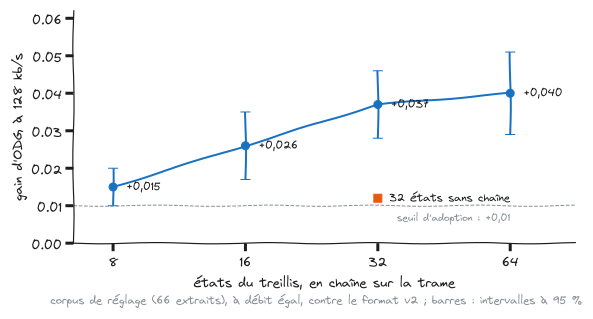

*Deuxième billet de la série « MULE, ou comment marche un codec audio moderne ».*

## L'idée qui a le plus rapporté est la plus vieille

Dans le [premier billet](https://berettavexee.github.io/2026/11/19/mule-anatomie-codec-audio/),
on a vu qu'un codec ne cherche pas à reproduire le signal : il cherche à cacher son erreur sous
le [seuil de masquage](https://en.wikipedia.org/wiki/Auditory_masking). Cette erreur vient d'un geste tout bête : **arrondir**. Chaque coefficient
de la [MDCT](https://en.wikipedia.org/wiki/Modified_discrete_cosine_transform) est remplacé par le multiple d'un pas D le plus proche, et l'écart moyen entre les
deux vaut à peu près D²/12. Diviser le pas par deux enlève 6 dB de bruit, et coûte en échange
environ un bit de plus par coefficient. Il n'y a pas de repas gratuit.

Sauf qu'il y en a un, presque. Il s'appelle la **quantification codée en treillis**, ou TCQ
(*Trellis-Coded Quantization*), et il gagne de la précision en piochant dans une grille deux
fois plus fine, tout en ne payant que le pas entier. Dans MULE, c'est l'idée qui a le plus rapporté : +0,06 d'[ODG](https://en.wikipedia.org/wiki/Perceptual_Evaluation_of_Audio_Quality) quand elle
est arrivée, puis encore +0,036 quand je l'ai poussée plus loin. À titre de comparaison, la
plupart des idées du projet se battent pour quelques millièmes.

Le plus vexant, c'est que je ne l'ai pas inventée. Elle a plus de trente ans, elle vient des
modems, elle dort dans une partie optionnelle de [JPEG 2000](https://fr.wikipedia.org/wiki/JPEG_2000) que personne n'utilise, et à ma
connaissance aucun codec audio grand public ne s'en sert. Ce billet raconte comment elle marche,
sans maths lourdes, et ce qu'elle a donné.

## Le problème : arrondir coûte cher

Le quantificateur le plus simple, celui de la v1 de MULE, c'est une règle graduée. On pose des
graduations tous les D, et chaque coefficient est remplacé par la graduation la plus proche.
L'erreur est toujours comprise entre −D/2 et +D/2, chaque coefficient est traité seul, sans
regarder ses voisins, et le décodeur n'a qu'une multiplication à faire.

Figure 1 : le quantificateur scalaire, une règle graduée au pas D ; chaque valeur est remplacée par la graduation la plus proche, et l'erreur reste entre −D/2 et +D/2
{: .caption}

C'est simple, et c'est presque optimal. Presque. La [théorie de l'information](https://fr.wikipedia.org/wiki/Th%C3%A9orie_de_l'information) dit qu'en
quantifiant **plusieurs nombres ensemble** plutôt qu'un par un, on peut faire mieux, et elle dit
même de combien : à haut débit, au plus 1,53 dB de bruit en moins pour le même nombre de bits.
On appelle ça le gain de granularité. L'intuition : une règle graduée découpe l'espace en petits
cubes, et les cubes sont une façon assez maladroite de paver l'espace. En dimension 2, des
[hexagones](https://fr.wikipedia.org/wiki/Pavage_hexagonal) (les alvéoles d'une ruche) font mieux que des carrés ; en dimension [8](https://en.wikipedia.org/wiki/E8_lattice) ou [24](https://fr.wikipedia.org/wiki/R%C3%A9seau_de_Leech), il existe
des pavages bien plus malins encore.

Le problème, c'est que ces pavages malins, il faut les stocker ou les calculer, et c'est
exactement ce que font les dictionnaires de [Vorbis](https://fr.wikipedia.org/wiki/Vorbis) (ses [*codebooks*](https://fr.wikipedia.org/wiki/Quantification_vectorielle)) ou la [PVQ](https://en.wikipedia.org/wiki/Pyramid_vector_quantization) d'[Opus](https://en.wikipedia.org/wiki/Opus_%28audio_format%29), avec les
conséquences que vous connaissez si vous avez lu le premier billet : de la RAM, ou une migraine.
La TCQ, elle, en récupère environ 1 dB sur les 1,53 possibles avec 8 états, à haut débit et
sans aucun dictionnaire. C'est là toute sa magie. À nos débits, un peu plus d'un bit par
coefficient, ce sera moins : on y revient plus bas.

## L'astuce : deux règles graduées qui s'entrelacent

On part d'une règle graduée **deux fois plus fine** : des graduations tous les D/2. Si on avait
le droit de toutes les utiliser, on aurait le bruit du demi-pas, et la facture du demi-pas.

On range alors ces graduations en quatre familles, chacune revenant toutes les deux
graduations : appelons-les D0, D1, D2 et D3, et elles se suivent dans cet ordre le long de la
règle, D0, D1, D2, D3, D0, D1… Puis on les regroupe par deux :

- la **règle paire**, faite de D0 et D2 : une graduation sur deux, donc un pas de D ;
- la **règle impaire**, faite de D1 et D3 : l'autre graduation sur deux, elle aussi au pas de D,
  mais décalée d'un demi-pas.

Chacune des deux règles a le même pas que le quantificateur scalaire : elle coûte donc le même
nombre de bits. Mais ensemble, elles forment la règle fine.

Figure 2 : les graduations au demi-pas, colorées par famille (D0, D1, D2, D3) ; au-dessus, la règle paire (D0 et D2) et la règle impaire (D1 et D3), chacune au pas D, décalées d'un demi-pas
{: .caption}

Si j'ai deux règles, il me faut un bit pour dire laquelle j'utilise ? Où se cache le gain ?
C'est toute l'astuce : **pour chaque coefficient, on n'a le droit qu'à une seule des deux règles
graduées, et c'est le choix fait sur le coefficient précédent qui décide laquelle**. Avoir pris
une graduation de la famille D0 plutôt que D2, par exemple, c'est choisir une valeur pour ce
coefficient-ci, et cette valeur fixe la règle imposée au suivant. Le bit qui dit « quelle règle »
n'est donc jamais envoyé : il voyage dans la valeur du coefficient d'avant, que le décodeur lit
de toute façon.

Une rotation fixe, D0, D1, D2, D3 à chaque coefficient, ne rapporterait rien : l'encodeur n'aurait
plus aucun choix, et chaque coefficient serait simplement arrondi sur une règle imposée d'avance.
Tout le gain vient de la liberté de choisir son chemin.

Comme chaque choix engage le coefficient suivant, l'encodeur n'arrondit
plus chaque valeur à l'aveugle : il cherche la **suite de choix** qui, sur toute la bande, colle
au mieux au signal, en comptant aussi les bits dépensés. Selon les chemins, un coefficient finit
souvent sur la règle qui l'arrange. Dans MULE, à débit égal, l'erreur baisse d'environ 0,4 dB par
rapport à l'arrondi simple. On est loin des 6 dB du demi-pas, mais pour un décodeur qui ne paie
presque rien, c'est beaucoup, et les mesures de qualité perçue y gagnent plus encore (on y vient).

Le décodeur, lui, n'a besoin d'aucune information supplémentaire : il connaît les valeurs qu'il
a déjà décodées, donc il connaît la règle en cours. Il lit un index, comme avec le scalaire, et
la règle lui dit à quelle graduation il correspond.

Un détail qui m'a fait sourire en l'implémentant : la règle impaire n'a pas de zéro (ses
graduations tombent à ±D/2, ±3D/2…). Quand on est sur elle, le signe est donc toujours envoyé,
même pour une valeur minuscule. 

Ça coûte un bit. L'encodeur a donc intérêt à s'organiser : en choisissant bien les coefficients
précédents, il peut arriver sur la règle paire juste quand se présente une valeur proche de zéro.
Encore faut-il des règles de passage précises entre les deux règles graduées : c'est le treillis.

## Le treillis : une machine à huit états

« Le choix précédent décide de la règle suivante » : il faut bien une règle de transition précise, et
c'est le **treillis** qui la donne. C'est une petite [machine à états](https://fr.wikipedia.org/wiki/Automate_fini). À chaque coefficient, la
machine est dans l'un de ses 8 états ; l'état dit quelle règle graduée est permise, et le choix
de la famille fait passer la machine dans l'état suivant. Dans MULE, depuis l'état t, on passe
à l'état (2t + 0) ou (2t + 1), modulo 8, selon la famille choisie. Ce sont exactement les tables
de la [partie 2 de JPEG 2000](https://jpeg.org/jpeg2000/) : je n'ai rien inventé.

Figure 3 : le treillis à 8 états, déroulé sur quelques coefficients ; chaque branche est étiquetée par la famille qu'elle impose
{: .caption}

D'où ça vient ? Des modems. Au début des années 1980, Gottfried Ungerboeck [a montré](https://doi.org/10.1109/TIT.1982.1056454) qu'en
choisissant les points émis sur une ligne téléphonique selon une machine à états de ce genre, on
gagnait plusieurs dB de robustesse sans élargir la bande : la [*modulation codée en treillis*](https://en.wikipedia.org/wiki/Trellis_coded_modulation),
qui a fait les beaux jours des modems téléphoniques (V.32 et V.32bis, 9 600 et 14 400 bit/s). 
En 1990, [Michael Marcellin et Thomas Fischer](https://doi.org/10.1109/26.46532) ont retourné l'idée : ce qui protège des points 
contre le bruit d'une ligne peut aussi placer des niveaux de quantification au plus près d'un 
signal. C'est la TCQ. Elle a fini dans JPEG 2000, puis, sous une forme cousine 
(la *quantification dépendante*), dans le codec vidéo [VVC](https://en.wikipedia.org/wiki/Versatile_Video_Coding).

Le coût pour le décodeur sur le baladeur : une table de 16 entrées, une parité et un décalage par
coefficient. Comparé à une IMDCT, c'est invisible.

## Viterbi : choisir tout le chemin d'un coup

Reste le vrai travail, côté encodeur : trouver la meilleure suite de choix. On ne peut pas
décider coefficient par coefficient, parce qu'un choix excellent maintenant peut imposer une
règle catastrophique au coefficient suivant. Et on ne peut pas essayer toutes les suites : avec
deux familles possibles par coefficient, une bande de 64 coefficients compte 2⁶⁴ chemins.

L'astuce s'appelle l'**[algorithme de Viterbi](https://fr.wikipedia.org/wiki/Algorithme_de_Viterbi)**, et c'est un peu celui du [routage](https://en.wikipedia.org/wiki/Dijkstra's_algorithm) sur un GPS *(Une autre de mes passions)*. 
Pour trouver le plus court chemin de Paris à Marseille, le GPS n'essaie pas toutes les routes : il retient, pour chaque
carrefour, le meilleur chemin qui y mène, et oublie les autres, puisque tout trajet qui passe
par ce carrefour a intérêt à y arriver par le meilleur chemin. Viterbi fait la même chose avec
les états du treillis : coefficient après coefficient, il garde pour chacun des 8 états le
meilleur chemin qui y arrive, et rien d'autre. À la fin de la bande, il prend le meilleur des 8
et remonte le chemin. Huit chemins à suivre au lieu de 2⁶⁴ : l'encodeur tourne environ deux fois
moins vite qu'avec le scalaire.

Figure 4 : une vraie bande de 16 coefficients d'une trompette (EBU SQAM), codée avec le treillis à 8 états de la v2 ; croix : les valeurs à quantifier ; carrés orange : l'arrondi scalaire ; ronds bleus : les niveaux choisis par la TCQ ; en dessous, l'état du treillis avant chaque coefficient : un état impair impose un niveau impair, entre deux graduations du scalaire
{: .caption}

Sur cette bande, prise au hasard, la TCQ ne fait pas une erreur plus petite que l'arrondi : elle
cherche le meilleur compromis entre erreur et bits, et c'est sur des milliers de bandes que le
gain apparaît. Ce qu'on voit bien, en revanche, c'est la règle du jeu : chaque fois que l'état est
impair, le niveau choisi tombe entre deux graduations du scalaire.

Ce qu'on minimise, c'est « erreur au carré + λ × bits » : le compromis [débit-distorsion](https://en.wikipedia.org/wiki/Rate%E2%80%93distortion_theory) du premier
billet, au niveau du coefficient. Et il a fallu le régler, parce que λ s'est révélé capricieux.
Sur mon corpus de réglage :

- **λ = 0** (on ne regarde que l'erreur) : 4,8 % de débit en plus, et 15 extraits qui se
  dégradent ;
- **λ = 0,3** : l'optimum, un seul extrait en recul (des triangles, évidemment) ;
- **λ = 1** : 59 extraits en recul sur 66. À trop vouloir économiser, le treillis préfère les
  niveaux bon marché, quitte à s'éloigner du signal, et sur un son tonal, un partiel qui disparaît
  ou qui change de niveau, ça s'entend.

### Ce qui est vraiment écrit dans le fichier

Reste une question que je me suis posée tard, et que vous vous posez peut-être : à chaque
coefficient, le Viterbi choisit une branche parmi deux. Comment le décodeur connaît-il ces choix ?
Il faudrait les lui envoyer, un bit par coefficient, non ?

Non : **les choix ne sont jamais écrits**. Ce qui est écrit, c'est la valeur de chaque
coefficient, exactement comme avec le scalaire : un index dans la règle en cours, et un signe.
Prenons les deux premiers coefficients de la figure 4. Le treillis part de l'état 0, qui est
pair : on est sur la règle paire, dont les graduations sont 0, ±D, ±2D… L'encodeur écrit « index 1,
négatif », et le décodeur lit −D. Or −D appartient à la famille D2 (les multiples impairs de D), et
c'est la famille qui désigne la branche : la machine passe dans l'état 1. État impair, donc règle
impaire, graduations ±D/2, ±3D/2… L'encodeur écrit « index 0, négatif » : le décodeur lit −D/2,
famille D3, et la machine passe dans l'état 3. Et ainsi de suite, coefficient après coefficient :
c'est le chemin dessiné en gras sur la figure 3.

Concrètement, chaque coefficient occupe dans le fichier, dans l'ordre :

- **un symbole d'index**, de 0 à 6, compressé par le codeur entropique avec un modèle qui dépend
  des deux coefficients précédents (ce sera le billet 3). Sur la règle paire, l'index u vaut u·D ;
  sur la règle impaire, (u + ½)·D. Le symbole 7 sert d'échappement pour les grands index : il est
  suivi de leur longueur, puis de quelques bits bruts ;
- **le signe, sur un bit brut** (1 pour négatif), qui n'est pas compressé : un coefficient de la
  MDCT a autant de chances d'être positif que négatif, il n'y a rien à gagner. Sur la règle paire,
  il n'est écrit que si l'index n'est pas nul, puisque zéro n'a pas de signe ; sur la règle
  impaire, il est toujours écrit, puisque son plus petit niveau est déjà ±D/2.

Nos deux coefficients s'écrivent donc « symbole 1, bit de signe 1 », puis « symbole 0, bit de
signe 1 » : sur la règle impaire, même l'index 0 a son signe. Et ces bits de signe pèsent lourd :
près d'un tiers du flux sur l'extrait d'ABBA du premier billet (figure 9).

Rappel de la figure 3 : le treillis à 8 états ; en gras, le chemin des premiers coefficients, celui que suit la figure 5
{: .caption}

Figure 5 : ce que le décodeur lit pour les quatre premiers coefficients de la figure 4 ; l'état impose la règle, le fichier ne contient qu'un index et un signe, et la famille de la valeur lue donne l'état suivant
{: .caption}

Le choix de la branche est donc contenu dans la valeur elle-même : choisir −D plutôt que 0 ou −2D,
c'est à la fois choisir une valeur et choisir un chemin. Et cette valeur, il faut l'envoyer de
toute façon. Elle coûte le prix d'un index sur une règle au pas D, c'est-à-dire ce que paie le
quantificateur scalaire, et le codeur entropique (billet 3) la compresse de la même façon. Le
chemin du Viterbi ne coûte donc pas un bit par choix : il ne coûte rien. À un détail près, on vient
de le voir : sur la règle impaire, le signe est toujours payé. C'est pour ça que le Viterbi compte les
bits dans son coût, et pas seulement l'erreur : quand il hésite entre deux chemins, il compare le
prix des valeurs qu'ils imposent, puisque le chemin lui-même est gratuit.

## Ce que ça a rapporté : le format v2

Au départ, MULE n'avait pas de TCQ. Mes notes de conception proposaient trois quantificateurs
pour la forme des bandes : le scalaire tout simple (le A), la TCQ (le B) et une version améliorée
de la PVQ d'Opus (le C). J'ai construit le codec avec le A, parce que c'était le plus simple,
puis j'ai branché le B et le C à sa place.

Résultat sur les 30 extraits de test, à débit égal : la TCQ gagne **+0,063 d'ODG à 128 kb/s et
+0,037 à 160**, sans un seul extrait en recul. L'écart avec Opus sur la note de base de [PEAQ](https://en.wikipedia.org/wiki/Perceptual_Evaluation_of_Audio_Quality)
diminue d'environ un tiers. Et pour une fois, mes oreilles ont confirmé : en [écoute à l'aveugle](https://fr.wikipedia.org/wiki/Test_ABX) à
160 kb/s, sur six extraits choisis pour être difficiles *(seize fois d'affilée les mêmes
triangles, puis seize fois les mêmes castagnettes, et rebelote pour chaque version : une
épreuve)*, le scalaire était transparent sur cinq extraits sur six (les triangles, encore ces
satanés triangles, étaient au seuil de détection) et la TCQ sur les six.

La PVQ, elle, a perdu. Pas de beaucoup en moyenne, mais lourdement sur les sons tonals : −0,64 sur
les triangles, −0,43 sur le [glockenspiel](https://fr.wikipedia.org/wiki/Glockenspiel) *(une sorte de
[xylophone](https://fr.wikipedia.org/wiki/Xylophone), en métal)*. Honnêtement, la PVQ est compliquée à appréhender : c'est de la géométrie en
dimension N, avec des problèmes de densité de points et de distance. Je ne sais pas pour vous,
mais moi, j'ai du mal à visualiser les pôles d'une sphère de dimension 12. La documentation
d'Opus est imbuvable. J'ai essayé de lire deux ou trois papiers sur le sujet, mais il faut se
rendre à l'évidence : je suis incapable de comprendre suffisamment la PVQ pour la configurer. En
plus, elle perdait face à la TCQ.

Figure 6 : la note PEAQ à 128 et 160 kb/s du quantificateur scalaire, de la TCQ et de la PVQ, face à Opus et Vorbis, sur le corpus de réglage (66 extraits), le seul où les trois quantificateurs ont été mesurés ensemble
{: .caption}

La TCQ est devenue le seul quantificateur du format v2. 

## La v3 : plus d'états, et un seul Viterbi pour toute la trame

En étudiant le treillis sur un petit simulateur, je me suis rendu compte d'un phénomène
intéressant : il perdait surtout dans les bandes courtes, celles des graves. Pourquoi ? Le
treillis repartait de l'état 0 au début de **chaque bande**. Or un treillis qui part d'un seul 
état met trois coefficients à ouvrir ses chemins (il faut le temps que les huit états soient atteignables). 
Dans une bande de 512 coefficients, on s'en moque ; dans les bandes graves de MULE, qui en comptent 8,
c'est presque la moitié de la bande qui se fait avec un état dégradé.

L'idée évidente : ne pas remettre le treillis à zéro, laisser chaque bande partir de l'état où la
précédente a fini. J'ai d'abord vérifié sur un petit simulateur, avant de toucher au codec. Et
l'idée évidente était fausse : enchaîner les bandes naïvement, chacune dans l'état laissé par la
précédente, fait **moins bien** que de repartir à zéro (−0,14 dB à 1,25 bit par coefficient, le
régime de MULE). La fin d'une bande, choisie sans penser à la suivante, lui impose un état de
départ qui l'arrange rarement.

Ce qui marche, c'est de faire **un seul Viterbi sur toutes les bandes de la trame**, pour que la
fin de chaque bande soit choisie en même temps que le début de la suivante. Et une fois le
treillis enchaîné, on peut lui donner plus d'états : avec des bandes trop courtes, des états
supplémentaires n'avaient pas le temps de servir. Un treillis de 64 états met six coefficients à
ouvrir tous ses chemins : dans une bande de 8, c'est presque toute la bande ; sur une trame
entière, c'est négligeable, et les états supplémentaires offrent à l'encodeur bien plus de
chemins entre lesquels choisir. Le simulateur donnait +0,17 dB à 32 états, +0,23 dB à 64.

Figure 7 : le gain du treillis sur le quantificateur scalaire selon le nombre d'états, avec redémarrage à chaque bande et en chaîne sur la trame (simulateur, 1,25 bit par coefficient)
{: .caption}

Dans le codec, sur le corpus de réglage, le gain monte avec le nombre d'états, de moins en moins
vite : +0,015 d'ODG à 8 états en chaîne, +0,026 à 16, +0,037 à 32, +0,040 à 64. Confirmé sur les
extraits de test : **+0,036 à 128 kb/s** pour le format v3, toutes les mesures sont concordantes. 
Le plus gros gain de l'encodeur depuis le passage à la TCQ.

Figure 8 : le gain en ODG dans le codec selon le nombre d'états du treillis en chaîne
{: .caption}

J'ai évidemment essayé 48 états, parce que pourquoi pas, et parce qu'entre 32 et 64 il y avait
peut-être un compromis. Il n'y en avait pas : 48 états font moins bien que 32 (+0,12 dB contre
+0,17). Les bons treillis viennent des [codes convolutifs](https://en.wikipedia.org/wiki/Convolutional_code) des télécoms, et ils aiment les
puissances de deux. J'aurais pu m'en douter, mais c'est plus simple de le mesurer.

Et pourquoi s'arrêter à deux règles ? Si deux règles décalées d'un demi-pas font gagner quelque
chose, quatre règles décalées d'un quart de pas, piochées dans une grille quatre fois plus fine,
devraient faire mieux. La question est naturelle, et Ungerboeck se l'était déjà posée pour ses
modems : doubler l'alphabet donne l'essentiel du gain, le quadrupler presque rien de plus. Je l'ai
quand même vérifié sur le simulateur. Résultat, à 1,25 bit par coefficient : entre +0,01 et
+0,03 dB selon le nombre d'états, soit rien du tout. Et il y a un prix caché : trois règles sur
quatre n'ont pas de zéro, et paient le signe sur toutes les petites valeurs, qui sont justement
la majorité des coefficients de MULE. Deux règles, c'est très bien.

Les coûts, maintenant. Pour le décodeur : 256 octets d'état en plus, et rien d'autre. Pour
l'encodeur, c'est une autre histoire : un Viterbi huit fois plus large, qui a fait tomber
l'encodage à 1,9 fois le temps réel. L'astuce pour regagner de la vitesse : le choix de
l'allocation de chaque bande (essayer a−1, a, a+1, voir le billet 1) a besoin d'estimer le coût
de chaque option, mais pas au bit près. Je fais donc ces estimations sur un petit treillis de
8 états, et je ne sors le grand treillis de 64 états que pour le codage final. Même qualité, à la
mesure près, et l'encodeur est revenu à environ quatre fois le temps réel.

## Je ne dirais pas que c'est un échec, mais que cela n'a pas marché

Le treillis a eu droit à son petit cimetière d'idées innovantes :

- **Des contextes qui connaissent l'état.** Le [codeur entropique](https://fr.wikipedia.org/wiki/Codage_entropique) devine mieux un
  symbole s'il sait sur quelle règle graduée on se trouve. Gain : 0,42 % de débit, sous mon seuil
  de 1 %, pour 3 Kio de RAM en plus sur le cœur B. Non.
- **Un treillis plus riche**, dont l'état porterait aussi le type de la bande. Fausse bonne idée :
  ce que sait la bande, c'est aux contextes du codeur entropique de l'exploiter, pas au treillis.
- **La TCVQ**, la version vectorielle de la TCQ : environ 0,5 dB de plus en théorie, et un décodeur
  bien plus lourd. Pas sur mon baladeur.
- **Un réglage automatique** de tous les paramètres autour du treillis de 64 états, par un
  algorithme d'optimisation ([CMA-ES](https://fr.wikipedia.org/wiki/CMA-ES)) : +0,004 sur les extraits qui servaient à régler, rien sur
  les autres. Les réglages faits à la main étaient déjà bons.

## Pourquoi personne ne l'utilise ?

Une idée de 1990, venue des modems et passée par l'image et la vidéo, a rapporté à MULE plus que tout mon travail sur
la psychoacoustique. Elle coûte presque rien au décodeur et ne demande aucun dictionnaire. Alors
pourquoi ne la trouve-t-on dans aucun codec audio grand public ?

Je n'ai pas de réponse sérieuse. Peut-être les brevets, à l'époque où [AAC](https://fr.wikipedia.org/wiki/Advanced_Audio_Coding) et Vorbis ont été
conçus. Peut-être parce que la PVQ d'Opus en récupère une partie autrement, en quantifiant les
coefficients ensemble. Peut-être parce que personne n'a eu besoin de serrer un codec dans 30 Kio
sur un Cortex-M3. Si vous connaissez la réponse, je suis preneur.

Au prochain épisode : une fois quantifiés, ces index doivent encore être écrits avec le moins de
bits possible, et on verra que la compression ne vient pas du codeur, mais du modèle.
