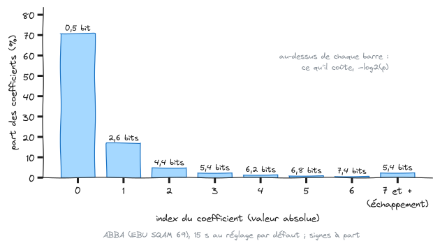
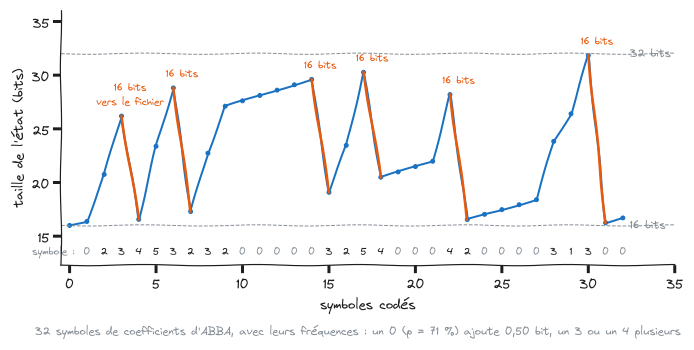
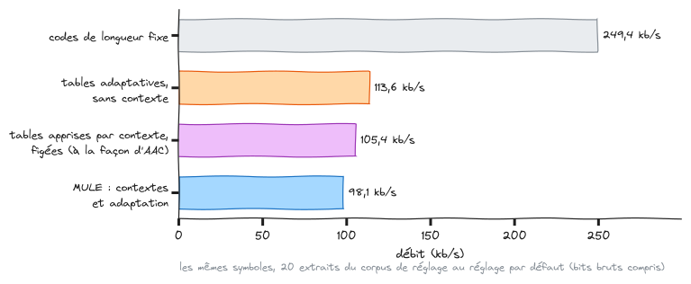
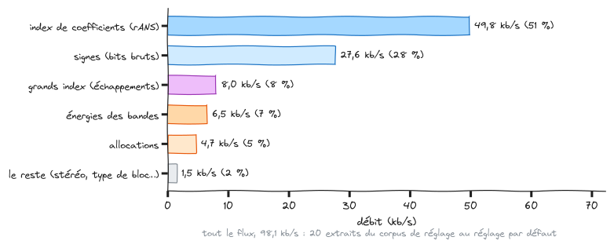

*Troisième billet de la série « MULE, ou comment marche un codec audio moderne ».*

## Le codeur parfait, et pourquoi on s'en fiche un peu

Dans les deux premiers billets, on a transformé de la musique en une longue suite de petits nombres : des énergies de bandes, des allocations, et surtout des index de coefficients, un par raie de la [MDCT](https://en.wikipedia.org/wiki/Modified_discrete_cosine_transform), choisis par le treillis. Il reste à les écrire dans le fichier, avec le moins de bits possible. C'est le travail du **codage entropique**, la partie du codec qui a la réputation d'être la plus savante : des noms de chercheurs, des articles pleins d'intégrales, et un vocabulaire qui fait peur (entropie, codage arithmétique, systèmes numériques asymétriques).

Voici le paradoxe de ce billet : dans MULE, le codeur proprement dit est **parfait**. Il écrit chaque symbole à 0,01 % près de ce que la théorie autorise. On ne peut rien y gagner, et n'importe quel bon codeur arithmétique fait pareil depuis 20 ans. Et pourtant, la différence entre écrire ces nombres naïvement et les écrire intelligemment *(comme MULE essaie de le faire)*, c'est un débit **divisé par 2,5**.

Tout le gain vient de la manière dont on va organiser et présenter les données au codec. Le codeur n'est qu'un comptable ; le vrai travail, c'est le modèle de donnée. Ce billet raconte les deux, en commençant par le comptable, parce qu'il est plus joli qu'on ne croit.

## Ce que coûte un symbole

Commençons par la seule formule du billet, et elle n'est pas trop méchante. Si un symbole a une probabilité p d'apparaître, l'écrire coûte au minimum **−log2(p) bits**. C'est [Claude Shannon](https://fr.wikipedia.org/wiki/Claude_Shannon), en 1948, et c'est la base de toute la compression sans perte.

En clair : un symbole qui tombe une fois sur deux coûte 1 bit ; une fois sur quatre, 2 bits ; une fois sur mille, à peu près 10 bits. Un symbole quasi certain ne coûte presque rien. Et ça marche aussi avec des fractions : un symbole à 90 % coûte 0,15 bit. Sur un grand nombre de symboles, c'est comme cela qu'on descend sous 1 bit par symbole.

Les index de coefficients de MULE sont un terrain rêvé pour ça. Ils vont de 0 à plusieurs centaines, mais la très grande majorité vaut 0 ou 1 : le treillis du billet 2 travaille autour de 1,25 bit par coefficient, il n'a pas les moyens de s'offrir de grands nombres partout. Si on écrivait chaque index sur une longueur fixe, disons 4 bits pour 16 valeurs, on paierait 4 bits pour écrire un zéro qui en vaut à peine un. Sur les opérations de codage de 20 extraits à 128 kb/s environ, des codes de longueur fixe donnent **249 kb/s**. MULE, avec exactement les mêmes symboles, en sort **98**.

Figure 1 : la répartition des index de coefficients sur un extrait SQAM, et ce que coûte chacun selon Shannon : les petits index, majoritaires, coûtent moins d'un bit ou à peine plus ; les grands, rares, coûtent cher mais pèsent peu au total
{: .caption}

Pour atteindre la borne de Shannon, il faut deux choses : **connaître les probabilités**, et **un codeur capable d'écrire des fractions de bit**. Le second problème est un problème résolu. Le premier est tout le sujet.

## rANS en une page

Le codeur le plus célèbre est celui de [Huffman](https://fr.wikipedia.org/wiki/Codage_de_Huffman) (1952) : chaque symbole reçoit un mot binaire, court pour les fréquents, long pour les rares. C'est ce qu'utilisent le MP3 et l'AAC. Son défaut : un mot fait un nombre entier de bits. Notre zéro qui sort 90 % du temps, qui vaut théoriquement 0,15 bit, en coûte 1 avec Huffman. Sur des symboles très déséquilibrés comme les nôtres, c'est du gâchis.

Le [codage arithmétique](https://fr.wikipedia.org/wiki/Codage_arithm%C3%A9tique) résout ça depuis les années 1970 : il écrit tout le message comme un seul nombre, et chaque symbole affine ce nombre selon sa probabilité, sans arrondi au bit. MULE utilise un cousin plus récent, **rANS**, de la famille des systèmes numériques asymétriques (ANS) inventés par [Jarek Duda](https://arxiv.org/abs/1311.2540) vers 2013, qu'on retrouve aujourd'hui dans [Zstandard](https://fr.wikipedia.org/wiki/Zstandard) (sous une forme à table) ou dans [JPEG XL](https://fr.wikipedia.org/wiki/JPEG_XL).

L'idée tient en une image. Le codeur tient un **état**, un seul nombre entier. Pour écrire un symbole de probabilité p, il **multiplie à peu près cet état par 1/p**, en glissant dans les chiffres du bas de quoi reconnaître le symbole. Un symbole fréquent le fait à peine grossir, un symbole rare le fait exploser. Comme ajouter log2(1/p) bits à un nombre, c'est exactement le multiplier par 1/p, l'état grossit de −log2(p) bits par symbole : Shannon, pile poil. Quand le nombre devient trop gros pour 32 bits, le codeur déverse les 16 bits du bas dans le fichier, et continue.

Le décodeur fait le chemin inverse : il regarde les 15 bits du bas de l'état, ce qui lui donne directement le symbole (c'est la « tranche » où il tombe dans la table des probabilités), puis réduit l'état d'autant (une multiplication et une soustraction), et recharge 16 bits du fichier quand il devient trop petit. Ni division ni flottant : une recherche dans une table, une multiplication, des décalages. Pour un baladeur sans unité de calcul flottant, c'est idéal.

Figure 2 : l'état de rANS sur quelques symboles : il grossit d'environ −log2(p) bits par symbole (peu pour un zéro fréquent, beaucoup pour un grand index rare), et déverse 16 bits dans le fichier quand il dépasse 32 bits
{: .caption}

Il y a une bizarrerie : rANS est une **pile**. Le dernier arrivé, premier sorti. Pour que le décodeur lise dans l'ordre, l'encodeur code donc les symboles **à l'envers**, ce qui l'oblige à connaître d'avance tout ce qu'il va écrire. Dans MULE, il bufferise un paquet de quatre trames, le code en partant de la fin, et le décodeur le relit dans le bon sens. C'est l'une des raisons pour lesquelles le flux est découpé en paquets.

Le verdict : sur ces 20 extraits, rANS écrit les symboles à **0,01 %** du coût idéal que donnent les probabilités du modèle. Rien à gratter.

Pourquoi rANS, alors ? Honnêtement, par accident. Je suis tombé sur les articles de Jarek Duda en cherchant désespérément quelque chose qui m'expliquait la PVQ d'Opus. Je suis reparti sans avoir compris la PVQ (on en a parlé au billet 2), mais avec un très bon codeur entropique. Il y a des échecs plus productifs que d'autres.

## Le modèle : prédire ce qui va suivre

Un codeur parfait ne sert à rien s'il ne connaît pas les bonnes probabilités. Et c'est là que tout se joue, parce que les probabilités ne sont pas fixes : elles **dépendent de ce qu'on sait déjà**.

Prenez un coefficient au milieu d'une bande. S'il est entouré de zéros, il a toutes les chances d'être nul lui aussi. Si ses deux voisins précédents valent 3 et 5, on est dans un pic du spectre, et un zéro devient improbable. Coder ces deux situations avec la même table de probabilités, c'est payer pour une ignorance qu'on n'a pas : le décodeur **connaît** déjà les voisins, il vient de les lire.

C'est ce qu'on appelle un **contexte** : on n'a pas une table de probabilités, mais plusieurs, et on choisit laquelle utiliser selon ce qui précède. MULE en a **135**, réparties en dix flux :

- **les index de coefficients**, de loin les plus nombreux : 96 contextes. Le choix se fait sur la taille des deux index précédents, sur celle du même coefficient dans la trame d'avant (remise à l'échelle si l'énergie de la bande a changé), et sur le pas de quantification de la bande : une bande fine et une bande grossière n'ont pas du tout les mêmes statistiques ;  
- **les énergies des bandes** : 9 contextes. On ne code d'ailleurs pas l'énergie elle-même, mais l'écart à une prédiction, faite à partir de la même bande dans la trame précédente et de la bande voisine du dessous (c'était la promesse du billet 1). Le contexte dépend de la zone de fréquences et de la taille de l'écart précédent : une prédiction qui vient de rater a des chances de rater encore ;  
- **les allocations** : 6 contextes, sur le même principe, par rapport à la bande voisine ou à la trame précédente selon ce qui coûte le moins ;  
- et quelques petits flux : la stéréo par bande, le type de bloc, les échappements des grands index, le niveau du bruit de remplissage depuis la v5.

Combien ça rapporte ? Sur les mêmes extraits, les mêmes symboles, avec des tables qui s'adaptent mais **sans contexte**, on est à 114 kb/s. Avec les contextes, à 98 kb/s. Les contextes valent à eux seuls **environ 14 % du débit**, pour un coût presque nul : le décodeur choisit une table au lieu d'une autre, c'est tout.

Figure 3 : le même flux de symboles écrit de quatre façons : codes de longueur fixe (249 kb/s), tables adaptatives sans contexte (114), tables apprises par contexte mais figées, à la façon d'AAC (105), et MULE, adaptatif avec contextes (98)
{: .caption}

Un dernier chiffre pour remettre les choses à leur place : sur ces 98 kb/s, **30 kb/s sont des bits bruts** que rien ne compresse, en grande partie les signes des coefficients (le billet 2 expliquait pourquoi la règle impaire les paie toujours). Le modèle travaille sur les 68 kb/s restants.

## Apprendre en marchant : l'adaptation

D'où viennent les probabilités de ces 135 tables ? Deux sources, et MULE utilise les deux.

**D'abord, des tables apprises.** J'ai fait tourner l'encodeur sur un corpus d'entraînement, compté combien de fois chaque symbole tombait dans chaque contexte, et figé ces comptes dans le décodeur : 4,9 Kio de tables. C'est ce que fait l'AAC avec ses tables de Huffman, à l'arrondi près. Avec ces tables seules, figées, on est à 105 kb/s.

Attendez, des tables fixes et précalculées ? Ce n'est pas un problème ? Pas vraiment. Quand j'avais travaillé sur le portage de Vorbis sur l'Echo Mini, l'une des constatations étonnantes était que les dictionnaires de Huffman de Vorbis (ses codebooks) étaient les mêmes pour tout un album. Vorbis a pourtant le droit d'en mettre sur mesure dans chaque fichier, mais la plupart des encodeurs se contentent de dictionnaires précalculés, choisis selon les paramètres d'encodage : la fréquence d'échantillonnage, le nombre de canaux, le niveau de qualité. Comme MULE ne tourne qu'en 44,1 kHz et 16 bits, une seule série de tables précalculées par version du format suffit *(plusieurs tables spécialisées depuis la v3)*. Et contrairement à Vorbis, MULE n'est pas limité aux tables fournies. Ce sont des points de départ, que le mécanisme d'adaptation fait évoluer par la suite. J'ai d'ailleurs oublié de mettre à jour ces tables de la v3 à la v5, sans impact majeur sur les performances.

**Ensuite, de l'adaptation.** Après chaque symbole, la table qui vient de servir glisse un peu vers ce qu'on vient de voir : le symbole lu devient un peu plus probable, les autres un peu moins. C'est le mécanisme du codec vidéo [AV1](https://aomedia.org/specifications/av1/), et il est d'une simplicité désarmante : chaque entrée de la table se rapproche de sa cible d'une fraction fixe de la distance, un seizième au début, puis un trente-deuxième, puis un soixante-quatrième une fois que le modèle a vu 32 symboles (un cran plus lent pour les grands alphabets). Ça apprend vite après un départ, et ça se stabilise ensuite. Un garde-fou : aucun symbole ne descend sous une probabilité minimale, sinon un symbole jugé « impossible » ne pourrait plus jamais être écrit.

L'adaptation rapporte **environ 7 %** de plus que les tables apprises seules : chaque morceau a ses habitudes, et le modèle les attrape en quelques dizaines de symboles.

Figure 4 : une table de probabilités qui s'adapte au fil d'un extrait, en partant de la table apprise ou d'une table uniforme ; la table apprise part déjà près du but, l'uniforme met plus de 150 symboles à s'en approcher, et le paquet clé suivant la remet à zéro
{: .caption}

Mais il y a un problème : un flux de musique doit pouvoir être pris en cours de route. On doit pouvoir faire des avances rapides, sauter à un point précis d'un morceau. Le décodeur ne peut pas décoder le morceau depuis le début pour retrouver l'état des 135 tables. MULE remet donc à zéro les états appris à chaque **paquet clé**, toutes les 0,93 seconde. D'où l'importance des tables de départ : sans remise à zéro, leur influence serait négligeable. Mais comme les tables repartent de zéro plus d'une fois par seconde, elles servent de point de départ et font gagner de précieux symboles d'apprentissage.

Il y a aussi un compromis. On obtient un système avec des tables beaucoup plus réduites que les tables de Huffman de Vorbis *(économiser la mémoire est l'une des priorités de MULE)*, mais il y a un prix à payer du côté du CPU et des accès mémoire. Mettre à jour une table, c'est toucher à toutes ses entrées, après **chaque** symbole. Sur le décodeur de la v2, cela représente, par trame, 1 335 symboles de coefficients, et plus de 20 000 entrées de tables. Le décodage entropique prenait à lui seul **63 % des instructions** sur le Cortex-M3, plus que la transformée inverse *(iMDCT)* et la synthèse réunies. La mise à jour seule représente environ 19 % de la charge CPU. La mémoire de l'Echo Mini ne brille ni par sa rapidité ni par ses temps d'accès.

En théorie, il existe des structures, comme l'[arbre de Fenwick](https://fr.wikipedia.org/wiki/Arbre_de_Fenwick), qui mettent à jour une table et y cherchent un symbole en O(log n) au lieu de O(n). Mais elles ne sont rentables qu'à partir de 32, voire 64 symboles ; nos tables en ont 8 ou 16.

J'ai donc essayé quelques optimisations existantes, comme de ne mettre à jour qu'un symbole sur deux : 9,6 % d'instructions en moins, mais 0,32 % de débit en plus. Accélérer l'adaptation pour compenser faisait pire, par surapprentissage. Comme la mémoire compte plus que le calcul sur ce baladeur et qu'on a des marges confortables, j'ai gardé la mise à jour complète. Normalement, quand un cœur tourne moins vite, on peut aussi baisser sa tension d'alimentation, et donc sa consommation. L'Echo Mini ne le fait pas *(c'est un défaut de conception)* : je l'ai mesuré, la charge CPU n'a aucun effet mesurable sur l'autonomie. Cela a grandement facilité ma décision.

## Ce qui ne se compresse pas

Certaines données se compressent mal avec le rANS. Trois catégories sont écrites brutes, sans compression.

**Les signes.** Une valeur de MDCT a autant de chances d'être positive que négative, et rien dans les voisins ne permet de deviner son signe. MULE coupe donc chaque coefficient en deux : sa valeur absolue d'un côté, son signe de l'autre. La valeur absolue suit une courbe en cloche très pointue, la laplacienne de la figure 1, que rANS compresse très bien. Le signe, lui, est un pile ou face : un bit, écrit brut. En théorie, on ne gagne rien à séparer les deux : coder −3 ou +3 d'un bloc coûte autant que coder 3 puis le signe. En pratique, on y gagne beaucoup : la table n'a plus que 8 symboles au lieu de 15, elle apprend deux fois plus vite après chaque paquet clé, un +3 et un −3 nourrissent la même case, et le signe ne coûte au décodeur ni recherche dans une table ni mise à jour. Un index nul de la règle paire n'a pas de signe ; sur la règle impaire, qui n'a pas de zéro, l'index 0 désigne ±D/2 et paie toujours le sien. Les signes pèsent près d'un tiers du flux (figure 5), un coût incompressible.

**Les grands indices.** L'alphabet des coefficients s'arrête à 7. Au-delà, on écrit un symbole d'échappement, une représentation du nombre (longueur et bits bruts). Comme pour les signes, la répartition est quasiment aléatoire. C'est rare, 2,5 % des coefficients, mais cher : le symbole d'échappement, la longueur et les bits bruts pèsent ensemble **8 % du flux**, plus que les énergies des bandes.

**L'alphabet, justement.** À l'origine, les coefficients avaient 16 symboles. Je l'ai réduit à 8 en v3, en me disant que ça coûterait un peu de débit mais allégerait le décodeur (une table de 8 entrées se met à jour deux fois plus vite qu'une de 16). Résultat : **0,00 %** d'augmentation du débit. Les échappements passent de 0,37 % à 1,40 % des symboles (2,5 % aujourd'hui, en v5), mais ce qu'ils coûtent est compensé par des tables plus petites, qui apprennent plus vite. Un gain gratuit de cycles CPU, inattendu mais apprécié.

Figure 5 : ce que contient un paquet, par catégorie : index de coefficients, signes et bits bruts, énergies, allocations, et le reste
{: .caption}

## Le cimetière des contextes

Évidemment, j'ai voulu optimiser. Si les contextes rapportent 14 %, des contextes plus malins devraient rapporter plus. Spoiler : non, ou si peu.

**Les contextes de la v0.** Le tout premier modèle pour les coefficients avait 480 contextes. En comptant ceux qui servaient vraiment, j'en ai trouvé 96. Les 384 autres étaient inatteignables, à cause d'une combinaison de conditions qui ne pouvait pas se produire. Je les ai retirés, et le flux produit n'a pas bougé d'**un seul bit**. Il y a un optimum très net sur le nombre de contextes de chaque modèle.

**Réapprendre les tables.** J'ai entraîné les tables de départ sur 200 morceaux qui n'avaient jamais servi au réglage : 0,1 % de gain. Même chose : des gains trop petits pour compter. Les tables n'ont pas besoin d'être parfaites, mais juste *assez bonnes* pour servir de point de départ au mécanisme adaptatif.

**Le contexte inter-trame.** Regarder le même coefficient dans la trame précédente, c'est la meilleure idée de la liste : environ 2 % à lui seul. Mais tous les raffinements que j'ai essayés par-dessus ont donné moins de 0,5 % chacun, des gains qui risquent de ne pas survivre à un autre corpus. Je me suis déjà fait avoir à aller chercher trop tôt des gains marginaux et à me retrouver avec une usine à gaz *(complexité)*.

**Les contextes qui connaissent le treillis.** En parlant d'usine à gaz, en voici une. Donner au modèle l'état du treillis, et sur quelle règle graduée il se trouve, l'aide un peu : on réduit le débit de 0,42 %, mais pour 3 Kio de RAM en plus et beaucoup plus d'accès mémoire dans le décodeur. Non retenu.

**Les contextes appris par la machine.** C'est ce qui se passe quand on demande à Claude d'optimiser l'encodeur. Cela reste une expérience intéressante. Il a décrit chaque coefficient en fonction d'un paquet de variables d'état (la classe d'allocation, les deux index précédents, le terme inter-trame, la parité de l'état du treillis, le type de bloc, la zone de fréquences, la position dans la bande), ce qui donne près de 40 000 situations différentes sur le corpus d'entraînement. Puis on laisse un algorithme de regroupement ([k-means](https://fr.wikipedia.org/wiki/K-moyennes)) rassembler les situations qui se ressemblent en un nombre fixe de contextes. Résultat :

- avec 96 contextes, autant qu'aujourd'hui : **−0,30 %** ;  
- avec 192 : −0,44 % ;  
- avec 384 : −0,52 % ;  
- et même avec une table par situation, la borne théorique, sans adaptation : −1,18 %.

Moins de 1 % dans le meilleur des cas, et rien ne garantit que ce gain tienne sur d'autres musiques. Le tout pour une table de correspondance de près de 40 000 entrées dans le décodeur et deux à quatre fois plus de modèles en RAM. Sur un cœur qui compte ses kilooctets, c'est non. Mes 96 contextes générés avec quelques lignes de python captent la majorité des gains, sont économes en mémoire, et on conserve la simplicité de conception.

La leçon est la même qu'ailleurs dans ce projet : quand le modèle initial est bon, les optimisations savantes pour aller chercher des gains marginaux se font au prix d'une augmentation très rapide de la complexité. Les gains les plus importants viennent des implémentations les plus simples. C'est pratique de passer après des gens plus malins que soi.

## Le codeur n'est qu'un comptable

Récapitulons. Sur le même flux de symboles :

- écrit naïvement : 249 kb/s ;  
- avec un codeur parfait mais sans rien deviner : 114 kb/s ;  
- avec des contextes et de l'adaptation : 98 kb/s.

Le codeur est *parfait* dans sa conception depuis le début, et n'importe quel codeur arithmétique correct ferait aussi bien. Tous les gains de compression viennent de l'amélioration de la prédictibilité.

C'est un compromis CPU/débit : le décodage entropique coûte du calcul et des accès mémoire. Sur le décodeur v2, il prenait plus de cycles que tout le traitement du signal.

Au prochain épisode : on a passé trois billets à gagner des bits et des dixièmes de dB. Mais comment déterminer si cela fait une différence sur l'écoute ? On parlera des machines qui écoutent à notre place (PEAQ, ViSQOL, Zimtohrli), de leurs désaccords, des tests à l'aveugle, et de la modestie de mes oreilles, qui n'ont rien distingué du tout.
