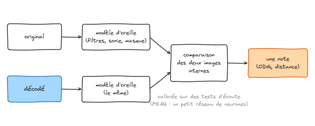
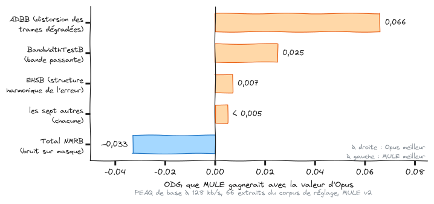
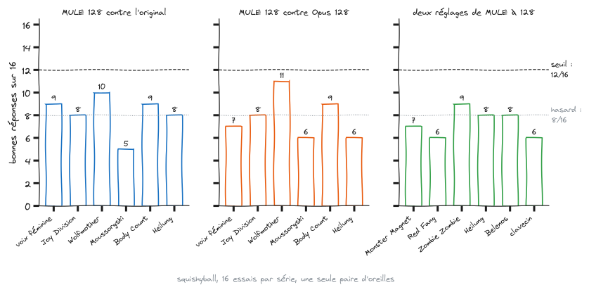
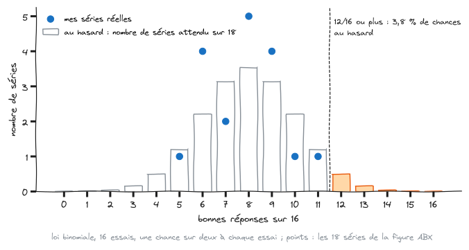

*Quatrième billet de la série « MULE, ou comment marche un codec audio moderne ».*

## Désillusion automatisée

Une nuit, j'ai lâché un algorithme d'optimisation sur l'encodeur de MULE. Son travail : tourner cinq boutons de réglage, encoder, faire noter le résultat, recommencer. Au bout de deux générations, il m'annonce un gain de **+0,031** sur la note de qualité. Pour situer, c'est le genre de gain pour lequel je me battais à la main pendant des jours.

Il n'avait rien trouvé dans le codec. Il avait trouvé une faille dans ma façon de mesurer, et il l'exploitait avec l'application d'un stagiaire qui a compris comment le chef lit les rapports.

Le problème de fond est simple. Régler un codec, c'est départager des milliers de variantes qui diffèrent de quelques centièmes de note. Mon oreille ne les entend pas (l'âge et des années de concerts de musique amplifiée ont fait leur travail). Et une écoute honnête, en aveugle, prend quinze à vingt minutes par extrait, avec des oreilles reposées. Il faut donc déléguer l'écoute à des programmes : des **juges automatiques**, qui comparent le son original et le son décodé et rendent une note.

Ce billet raconte ces juges. Ils sont rapides, infatigables et reproductibles. Ils se contredisent aussi, se font berner, comptent des choses que personne n'entend et ratent des choses que j'entends. Et pourtant ils sont essentiels à ce projet.

## Ce qu'on demande à un juge

La première idée, la plus naïve, c'est de soustraire le décodé de l'original et de mesurer ce qui reste : le [rapport signal sur bruit](https://fr.wikipedia.org/wiki/Rapport_signal_sur_bruit). C'est inutile pour un [codec](https://fr.wikipedia.org/wiki/Codec) perceptif, qui dégrade le signal et donc **ajoute du bruit exprès**, là où on ne l'entend pas. Tout le billet 1 tenait là-dessus : on jette ce que le masque cache. Un bon codec a un rapport signal sur bruit médiocre, et c'est normal. C'est la répartition du bruit qui nous intéresse.

Un juge doit donc écouter comme une oreille. Ils suivent tous à peu près le même schéma : un **modèle d'oreille** (des bancs de filtres qui imitent la [cochlée](https://fr.wikipedia.org/wiki/Cochl%C3%A9e), une loi de [sonie](https://fr.wikipedia.org/wiki/Sonie), un masque) transforme chaque signal en une image interne, puis on compare les deux images. Enfin, la comparaison est convertie en note, calibrée sur des tests d'écoute réels. Autrement dit, on confronte notre modèle [psychoacoustique](https://fr.wikipedia.org/wiki/Psychoacoustique) et notre répartition des bits au modèle d'écoute du juge.

Figure 1 : le schéma commun aux juges automatiques : l'original et le décodé passent dans le même modèle d'oreille, on compare les deux images internes, et la comparaison devient une note calibrée sur des tests d'écoute
{: .caption}

Les notes ne sont pas toutes sur la même échelle. [PEAQ](https://en.wikipedia.org/wiki/Perceptual_Evaluation_of_Audio_Quality) rend un **ODG** (Objective Difference Grade), de −4 (« très gênant ») à 0 (« imperceptible »). D'autres rendent une **distance** : 0 pour deux sons identiques, et plus c'est grand, pire c'est. À 128 kb/s, tout se joue entre −0,3 et 0 d'ODG. On va chercher des gains marginaux.

## Les quatre juges

**PEAQ** est l'ancêtre, normalisé par l'[UIT](https://fr.wikipedia.org/wiki/Union_internationale_des_t%C3%A9l%C3%A9communications) en 1998 (BS.1387) ; j'utilise l'implémentation libre GstPEAQ. Il a deux modes, de base et avancé, qui ne sont pas toujours d'accord. Calibré sur les codecs de la fin des années 1990, il sature près de la transparence.

**Le NMR**, le rapport bruit sur masque, mesure de combien le bruit dépasse le masque, bande par bande. Je le calcule avec mon propre modèle psychoacoustique : c'est un écart par rapport à notre propre modèle, et non par rapport à un modèle calé sur des écoutes. Le plus lisible, et le plus suspect (j'y reviens plus bas).

**Zimtohrli**, de Google, est le plus récent et c'est devenu mon premier juge. Il découpe le son en 128 canaux, d'environ 20 Hz à 20 kHz, et sépare deux choses : l'**intensité** (le niveau local est-il le même ?) et la **structure** (la texture, la façon dont l'énergie se répartit et bouge, est-elle la même ?). Cette séparation servira à la fin du billet.

Un cinquième, **ViSQOL**, de Google aussi, a été retiré lors du passage à la v4. Il saturait près de la transparence, et c'était souvent le seul juge en désaccord, sans que je parvienne à comprendre pourquoi.

| Juge | Ce qu'il mesure | Échelle | Défaut connu |
|---|---|---|---|
| PEAQ de base | 11 variables, un réseau de neurones | ODG, −4 à 0, plus haut = mieux | sature près de 0 ; valorise énormément la bande passante au-dessus de 17 kHz |
| PEAQ avancé | une autre combinaison de variables | ODG, plus haut = mieux | même âge, mêmes limites |
| NMR | le bruit au-dessus du masque, bande par bande | dB, plus bas = mieux | juge et partie |
| Zimtohrli | intensité et texture, sur 128 canaux | distance, plus bas = mieux | jeune, peu de recul publié |

## Le piège des 20 kHz

Le premier vrai diagnostic m'a appris à me méfier. À 128 kb/s, PEAQ de base mettait MULE environ 0,06 d'ODG derrière [Opus](https://en.wikipedia.org/wiki/Opus_(audio_format)). D'où venait l'écart ?

PEAQ a une propriété pratique. Il calcule onze variables intermédiaires (les MOV, pour *Model Output Variables* : le bruit sur le masque, la bande passante, la modulation…), puis les passe dans un petit [réseau de neurones](https://fr.wikipedia.org/wiki/R%C3%A9seau_de_neurones_artificiels) qui rend l'ODG. Ces variables sont visibles. On peut donc le réévaluer en remplaçant une seule variable de MULE par celle d'Opus, et voir de combien la note bouge. C'est une attribution, variable par variable.

Figure 2 : l'écart de PEAQ entre MULE et Opus à 128 kb/s, attribué à chacune de ses variables : la distorsion des trames dégradées (+0,066) et la bande passante (+0,025) pèsent pour Opus, le bruit sur masque total (−0,033) pour MULE
{: .caption}

La plus grosse part venait de la distorsion concentrée dans quelques trames, un vrai sujet, qui a nourri des semaines de travail. La deuxième était la **[bande passante](https://fr.wikipedia.org/wiki/Bande_passante)** : la dernière bande de MULE s'arrête à 19,95 kHz, celle d'Opus monte à environ 20,4 kHz. Ça valait 0,025 d'ODG. Personne n'entend la différence entre 19,95 et 20,4 kHz, à part peut-être les [chauves-souris](https://fr.wikipedia.org/wiki/Chauve-souris) et les adolescents de 12 ans. J'ai quand même testé une 23e bande pour aller jusqu'au bout du spectre. Verdict : un artefact de PEAQ, pas un défaut du codec. Écartée.

La leçon vaut pour tous les juges : un juge note aussi ce qu'il sait mesurer, pas réellement ce que l'on entend. Si on optimise aveuglément sa note, on finit par coder des ultrasons pour faire plaisir à un réseau de neurones de 1998. D'autres modèles psychoacoustiques font d'autres choix : l'encodeur [AAC](https://fr.wikipedia.org/wiki/Advanced_Audio_Coding) d'Apple coupe allègrement dans les hautes fréquences. Il obtient un score médiocre dans les tests automatisés à des débits où il est complètement transparent en [écoute ABX](https://fr.wikipedia.org/wiki/Test_ABX).

Remarquez aussi la seule barre de l'autre côté : selon le bruit sur masque total, MULE est *meilleur* qu'Opus. Le même juge, sur la même trame, voit MULE devant sur une variable et derrière sur une autre. Tous les modèles ont leurs spécificités et ne se valent pas.

## Quand les juges ne sont pas d'accord

Pour mesurer MULE contre Opus et l'AAC d'Apple, j'ai fait tourner une campagne sur 300 morceaux de ma bibliothèque, tirés au hasard, chaque codec réglé pour le même débit moyen. Voici, pour chaque juge, la part des morceaux où MULE fait mieux qu'Opus.

Figure 3 : sur 300 morceaux, la part où MULE bat Opus selon chaque juge : à 96 kb/s, Zimtohrli voit une égalité (51 %), PEAQ de base préfère Opus (30 %), PEAQ avancé et le NMR préfèrent MULE (84 et 91 %) ; à 160 kb/s, trois juges sur quatre donnent MULE devant sur presque tous les morceaux, PEAQ de base reste à 49 %
{: .caption}

À 96 kb/s, c'est la cacophonie. Zimtohrli voit une égalité parfaite, un morceau sur deux. PEAQ de base préfère Opus sur 70 % des morceaux. PEAQ avancé et le NMR préfèrent MULE sur 84 et 91 %. Quatre juges, trois verdicts. À 160 kb/s, ça se calme : trois juges donnent MULE devant sur 98 à 99 % des morceaux, et PEAQ de base reste obstinément à pile ou face, ce qui correspond surtout à sa saturation près de zéro.

Qui croire ? J'ai fini par écrire une règle, et par m'y tenir :

1. **Zimtohrli d'abord**, parce que c'est celui dont les verdicts collent le mieux à ce que j'entends à ces débits ;
2. puis **PEAQ** (les deux modes) et **le NMR** ;
3. un changement de l'encodeur est adopté si les juges sont d'accord et qu'**aucun extrait ne recule** de plus de 0,02 d'ODG ;
4. **s'ils ne sont pas d'accord, c'est l'écoute qui tranche**, ou à défaut l'analyse des [spectrogrammes](https://fr.wikipedia.org/wiki/Spectrogramme).

Le cas d'école, c'est le réglage `m6z1`. Zimtohrli l'aimait beaucoup : 12 à 13 % de distance en moins, meilleur sur presque tous les extraits. PEAQ de base reculait un peu, de façon cohérente. Règle non remplie, donc écoute : 96 essais en aveugle sur six extraits, 44 bonnes réponses, soit 46 %, moins bien que le hasard. Je n'entendais aucune différence, ni là où PEAQ pénalisait le réglage, ni là où Zimtohrli le favorisait. Adopté, au bénéfice de Zimtohrli.

## L'optimiseur qui triche

Revenons à la campagne d'optimisation automatique du début. L'algorithme s'appelle [CMA-ES](https://fr.wikipedia.org/wiki/CMA-ES) : il essaie une population de réglages, garde les meilleurs, et déplace sa population vers eux, génération après génération. Il lui faut une note par candidat. Je lui avais donné « l'ODG moyen à 128 kb/s, à débit égal ».

Sauf qu'un réglage de l'encodeur change aussi le débit. Pour comparer à débit égal, j'encodais chaque candidat à deux réglages de qualité fixes, puis j'[interpolais](https://fr.wikipedia.org/wiki/Interpolation_num%C3%A9rique) la note à 128 kb/s. Les candidats gourmands, ceux qui dépensaient plus de bits, dépassaient 128 kb/s à mes **deux** points de mesure. La note « à 128 » n'était plus interpolée, mais **[extrapolée](https://fr.wikipedia.org/wiki/Extrapolation_(math%C3%A9matiques))**. Et comme la courbe qualité-débit est [concave](https://fr.wikipedia.org/wiki/Fonction_concave), l'extrapolation surestimait la note.

Figure 4 : pourquoi l'extrapolation triche : sur une courbe qualité-débit concave, la droite tirée par deux mesures toutes deux au-delà de 128 kb/s, prolongée jusqu'à 128, passe au-dessus de la vraie courbe et annonce une note trop haute ; avec deux mesures de part et d'autre de 128 kb/s, l'erreur devient négligeable
{: .caption}

Figure 5 : à gauche, le premier essai : le gain annoncé par CMA-ES suit le débit du candidat, et tous les « gains » au-delà de 128 kb/s sont extrapolés ; à droite, le second essai, où 128 kb/s est toujours encadré : plus aucun candidat ne bat le réglage de départ
{: .caption}

La figure est cruelle. À gauche, le gain annoncé suit presque parfaitement le débit du candidat ([corrélation](https://fr.wikipedia.org/wiki/Corr%C3%A9lation_(statistiques)) de 0,8). Tous les candidats « gagnants » sont à droite de la ligne des 128 kb/s. CMA-ES n'avait pas trouvé de meilleur réglage : il avait trouvé que dépenser plus de bits faisait monter la note, grâce à l'erreur d'extrapolation.

À droite, le second essai : pour chaque candidat, je cherche d'abord les deux qualités qui donnent 120 et 136 kb/s, puis je note entre les deux. Le débit visé est toujours encadré. Meilleur gain : +0,0006, c'est-à-dire du bruit de mesure. J'ai arrêté après deux générations.

Morale : un optimiseur trouve toujours la faille de la mesure avant le gain réel, parce que c'est plus facile. Toute comparaison « à débit égal » doit encadrer le débit, pour chaque candidat. C'est pour cette raison que j'ai modifié la comparaison des codecs pour m'assurer que les débits moyens interpolés se situent toujours entre deux points de mesure réels. Idéalement, il faudrait même trois points, pour suivre la courbure de la courbe qualité-débit au lieu de tirer un simple segment entre deux points.

## Quand un indicateur devient un objectif

Il y a un biais plus sournois, que je dois avouer avant que quelqu'un ne le fasse à ma place. MULE a été réglé majoritairement sur ces modèles. Opus et AAC ont été réglés à l'oreille, pendant des années, par des oreilles expertes des tests ABX. Si MULE est devant sur ces juges, c'est en partie parce qu'il a été entraîné à plaire à ces modèles. C'est la [loi de Goodhart](https://fr.wikipedia.org/wiki/Loi_de_Goodhart) : quand une mesure devient un objectif, elle cesse d'être une bonne mesure.

Le pire, c'est le NMR. Je le calcule avec le même modèle psychoacoustique que celui qui décide, dans l'encodeur, où mettre le bruit. On évalue donc le [bruit de quantification](https://fr.wikipedia.org/wiki/Bruit_de_quantification) avec l'algorithme même qui l'a réparti. C'est d'autant plus contestable quand on applique le modèle de MULE à un autre codec comme Opus ou l'AAC : sur cet indicateur, MULE bat Opus sur 91 à 99 % des morceaux. Ce n'est pas complètement inutile : cela permet de vérifier que l'encodeur fait ce qu'on attend de lui, ou de repérer les différences d'allocation avec d'autres codecs.

J'ai mis en place quelques garde-fous, imparfaits :
- je règle sur un groupe d'extraits (*dev*, 66 extraits), je valide sur un autre (*test*, 30), et je confirme sur une campagne de 300 morceaux que l'encodeur n'a jamais vus ;
- je regarde plusieurs juges : Zimtohrli, PEAQ et NMR ;
- je fais régulièrement passer le tout devant une paire d'oreilles (de mauvaises oreilles).

Ça ne supprime pas le biais, mais cela limite le [surapprentissage](https://fr.wikipedia.org/wiki/Surapprentissage). En développeur solitaire, je ne peux pas rivaliser avec des décennies d'écoute en aveugle par des oreilles expertes.

Un autre piège aurait été de reprendre tel quel le modèle psychoacoustique de Zimtohrli. D'abord, il évalue, mais ne dit pas quelles fréquences masquer ni comment attribuer les bits. Ensuite, on aurait recréé le cas du NMR : un juge et partie.

Et le juge le moins fiable reste parfois l'auteur. Pendant plusieurs jours, mes fichiers de résultats arrondissaient chaque note à quatre chiffres après la virgule, alors que les distances de Zimtohrli valent entre 0,0001 et 0,0009. J'ai soigneusement comparé des zéros entre eux, et tiré des conclusions de résultats tronqués.

## La cour d'appel : l'ABX

Quand les juges ne sont pas d'accord, ou quand je veux savoir si un écart s'entend, je fais un test **ABX**. Le programme (squishyball) me fait écouter A, B, puis X, qui est l'un des deux, tiré au hasard. Je dois dire lequel. Seize essais par série ; il faut au moins **12 bonnes réponses sur 16** pour que le résultat ait moins de 5 % de chances d'être dû au hasard. En tirant à pile ou face, on tourne autour de 8.

Figure 6 : les scores ABX de trois séries : MULE à 128 kb/s contre l'original, MULE contre Opus au même débit, et deux réglages de MULE entre eux ; aucun extrait n'atteint le seuil de 12/16
{: .caption}

J'ai pris les six extraits où PEAQ voyait le plus grand écart entre MULE et Opus. Contre l'original, MULE à 128 kb/s : je n'ai rien entendu, au mieux 10/16 sur [Wolfmother](https://fr.wikipedia.org/wiki/Wolfmother). MULE contre Opus au même débit : rien, au mieux 11/16, toujours Wolfmother. L'écart que PEAQ mesurait, environ 0,05 d'ODG, ne s'entend pas, du moins pas par moi.

Figure 7 : les scores qu'on obtient en répondant au hasard, sur 16 essais (loi binomiale) : 12/16 ou plus n'arrive que 3,8 % du temps ; mes 18 séries réelles tombent toutes dans la bosse du hasard, entre 5 et 11
{: .caption}

Mes 18 séries ressemblent exactement à ce que donnerait une pièce de monnaie : une bosse autour de 8, aucun score au-delà de 11. Ce n'est pas la preuve que la différence est inaudible pour tout le monde, seulement que je ne l'entends pas.

J'ai régulièrement fait des tests ABX sur les morceaux qui obtenaient les plus mauvaises notes, pour identifier les points faibles de MULE. Cela m'a permis de repérer quelques anomalies, comme un live de [Joy Division](https://fr.wikipedia.org/wiki/Joy_Division), présent dans cette série de morceaux tirés au hasard : c'était l'un des pires extraits de MULE face à Opus selon PEAQ, et c'est le pire de toute la campagne de 300 morceaux face à Opus. C'est un enregistrement live de 1980, sur [bande magnétique](https://fr.wikipedia.org/wiki/Bande_magn%C3%A9tique), saturé jusqu'à la moelle. En ABX : 8/16 contre l'original, 8/16 contre Opus, le hasard parfait. Les juges s'acharnent sur un morceau dont la source est déjà abîmée, et l'optimiser n'aurait rien apporté au reste du corpus.

J'ai aussi un gros biais : une seule paire d'oreilles, de qualité très médiocre, deux casques, des [DAC](https://fr.wikipedia.org/wiki/Convertisseur_num%C3%A9rique-analogique) d'entrée de gamme, et rarement plus d'une heure par séance. Les oreilles se fatiguent. Et j'ai une vie animée : un des matins d'après campagne, je sortais d'un improbable [fest-noz](https://fr.wikipedia.org/wiki/Fest-noz) avec quatre [cornemuses](https://fr.wikipedia.org/wiki/Cornemuse) la veille. Autant dire que j'étais incapable d'entendre quoi que ce soit dans le haut des aigus. Malgré tous leurs défauts, les juges automatiques n'ont pas d'[acouphènes](https://fr.wikipedia.org/wiki/Acouph%C3%A8ne).

Ce que ces écoutes disent, au fond : à 128 kb/s, MULE, Opus et l'AAC d'Apple sont probablement transparents pour moi sur presque tout. On se bat pour des écarts que la majorité des auditeurs n'entendent pas, et pour des dégradations sur des extraits particulièrement difficiles. Sur un baladeur, surtout : il ne faut pas oublier que MULE est destiné à tourner sur des baladeurs d'entrée de gamme, probablement avec des écouteurs intra-auriculaires. Ma configuration de test est déjà bien meilleure que la cible.

Ce qui fait la qualité d'un codec, ce n'est pas uniquement son taux de compression, mais la prévisibilité du résultat. Personne ne veut d'un codec excellent en moyenne, mais catastrophique sur un morceau sur quatre.

Figure 8 : la distance Zimtohrli de chacun des 300 morceaux, pour MULE, Opus et l'AAC d'Apple à 96, 128 et 160 kb/s ; à 128 kb/s, la médiane de MULE est 2,7, celle d'Opus 3,3 et celle de l'AAC 4,2, mais chaque codec s'étale de moins de 1 à plus de 5, et les nuages se recouvrent largement
{: .caption}

Un codec n'a pas *une* qualité. Comme ces distributions sont loin d'être des gaussiennes, l'écart type ne veut pas dire grand-chose ; on mesure plutôt l'étendue entre le 5e et le 95e [centile](https://fr.wikipedia.org/wiki/Centile) (P5–P95), qui contient 90 % des morceaux. À 128 kb/s, elle vaut 2,2 pour MULE (de 1,3 à 3,5), 2,8 pour Opus (de 1,7 à 4,5) et 3,4 pour l'AAC (de 2,4 à 5,9). Les [médianes](https://fr.wikipedia.org/wiki/M%C3%A9diane_(statistiques)) (2,7 pour MULE, 3,3 pour Opus, 4,2 pour l'AAC) sont moins éloignées. L'écart entre deux morceaux d'un même codec dépasse largement l'écart entre la médianne de deux codecs.

## Identifier les anomalies et les exceptions

Une moyenne sur 300 morceaux cache une réalité plus complexe. La seule façon d'améliorer le codec à partir des écoutes automatiques est de descendre progressivement : au morceau, puis à la seconde, puis à la bande de fréquence fautive.

Parmi les défaites de MULE face à Opus, il y a l'*Ode pour l'anniversaire de la reine Marie* de [Purcell](https://fr.wikipedia.org/wiki/Henry_Purcell), du chant choral avec un ensemble [baroque](https://fr.wikipedia.org/wiki/Musique_baroque). Pas de défaut d'enregistrement, contrairement à d'autres. Mais une défaite à tous les débits selon Zimtohrli, alors que PEAQ avancé et le NMR préfèrent MULE. Je ne peux pas vous faire écouter cet extrait, qui est sous droits, mais voici ses spectrogrammes.

Figure 9 : les spectrogrammes de l'ode de Purcell, l'original en haut, MULE à 96 kb/s au milieu, Opus à 96 kb/s en bas, sur la même échelle de niveau ; au-dessus de 5 kHz, la texture de MULE est plus lisse et plus floue que celle de l'original ; Opus garde mieux le grain, mais laisse par moments des trous noirs entre 12 et 16 kHz
{: .caption}

Rien ne saute aux yeux, et c'est bien le problème : les deux codecs gardent l'essentiel. Il faut regarder le haut du spectre. Au-dessus de 5 kHz, l'original a un grain fin, fait de traits verticaux et d'harmoniques ; chez MULE, cette zone devient une brume plus uniforme. Opus garde mieux ce grain, au prix de trous francs, entre 12 et 16 kHz, où il n'a rien reconstruit. Zimtohrli préfère pourtant nettement Opus : il semble pardonner un trou bref plus facilement qu'une texture lissée partout. (Opus dépense ici un peu plus : 97,9 kb/s contre 92,3 pour MULE.)

Le même phénomène se voit sur le [quatuor à cordes](https://fr.wikipedia.org/wiki/Quatuor_%C3%A0_cordes) de la collection [EBU](https://fr.wikipedia.org/wiki/Union_europ%C3%A9enne_de_radio-t%C3%A9l%C3%A9vision) SQAM, au même débit pour les deux codecs.

Figure 10 : en haut, la distance Zimtohrli seconde par seconde sur le quatuor à cordes de l'EBU, MULE et Opus au même débit ; en bas, sa décomposition par région de fréquence : la perte de MULE est concentrée entre 2,8 et 6 kHz et entre 10 et 15 kHz, et c'est presque uniquement de la structure, pas de l'intensité
{: .caption}

En haut, Zimtohrli seconde par seconde. Sur le quatuor, MULE est derrière sur 14 fenêtres sur 23 ; sur Purcell, c'était 58 sur 59. Ce n'est donc pas un accident localisé, mais un défaut d'encodage. En bas, la décomposition par région du quatuor : MULE fait mieux qu'Opus sous 2,8 kHz, mais perd entre 2,8 et 6 kHz et entre 10 et 15 kHz, les mêmes régions que sur Purcell. Et la perte est presque entièrement dans la **structure** : la part d'intensité est si petite qu'elle disparaît sur la figure. Autrement dit, MULE met la bonne *quantité* de bruit, mais pas avec la bonne *texture*.

Figure 11 : la perte de structure mesurée par Zimtohrli sur le quatuor, case par case dans le temps et en fréquence, pour MULE et pour Opus au même débit, puis leur différence : les taches rouges, où MULE est pire, s'alignent entre 3 et 6 kHz et entre 10 et 15 kHz ; Opus perd surtout autour de 100 Hz
{: .caption}

La carte rend le diagnostic visible : la perte de MULE n'est pas un accident sur quelques notes, mais deux bandes de taches rouges qui courent tout le long de l'extrait, aux fréquences où il remplit avec du bruit plat. Opus a aussi ses points faibles, en bleu, surtout dans le grave.

Deux fausses pistes d'abord. Certaines bandes, au bord du masque, basculaient d'une trame à l'autre entre « codée » et « remplie de bruit » ; une hystérésis a fait passer ce papillotement de 21 à 8 % des trames sur Purcell, sans effet sur la note. Faire varier le niveau du bruit de remplissage n'a rien donné non plus.

L'hypothèse qui reste : dans ces régions, MULE code peu d'impulsions (un tiers des coefficients d'une bande codée sont non nuls) et remplit le reste avec du bruit plat. Opus, lui, remplit les trous en **repliant** du spectre déjà décodé, étale ses impulsions et conserve exactement l'énergie de chaque bande : son remplissage a la texture du signal. MULE sait replier aussi, mais seulement dans les trames courtes, celles des attaques. C'est une hypothèse cohérente avec les mesures, pas une démonstration, et la corriger demanderait de toucher au format.

Dernière anecdote de cette plongée : sur un autre extrait perdant, un concerto de [Beethoven](https://fr.wikipedia.org/wiki/Ludwig_van_Beethoven), la différence entre les deux codecs se résumait au niveau du bruit qu'ils mettent à la place du souffle de l'enregistrement, au-dessus de 12 kHz. Dans ce souffle, une raie fine, à **15 625 Hz** pile. C'est la fréquence de balayage des lignes d'un téléviseur [cathodique](https://fr.wikipedia.org/wiki/Tube_cathodique) au standard européen ([PAL](https://fr.wikipedia.org/wiki/Phase_Alternating_Line)) : il y avait probablement un téléviseur ou un moniteur allumé près des micros. Les juges mesurent tout, y compris l'écran du preneur de son.

Figure 12 : le spectrogramme de l'original du concerto de Beethoven et son spectre moyen : au-dessus de 12 kHz, il ne reste que le souffle de l'enregistrement, traversé d'une raie fine et continue à 15 625 Hz, qui dépasse nettement du souffle dans le spectre moyen
{: .caption}

## Conclusion : des juges, pas des oracles

Les juges automatiques sont indispensables pour régler un codec, et dangereux pour prendre des décisions. Ils notent ce qu'ils savent mesurer, pas forcément ce qu'on entend. Ils se contredisent. Ils se font abuser par le premier optimiseur venu. Et on tombe vite dans le surapprentissage d'un modèle ou d'un codec particulier.

Ce que j'en ai tiré tient en quatre règles :

1. toujours avoir plusieurs juges ;
2. définir leur hiérarchie à l'avance ;
3. faire des statistiques sur un grand nombre de morceaux variés, ce qui permet de concentrer le temps d'oreille disponible, et reposée, sur les extraits qui font vraiment la différence ;
4. et peut-être la plus utile : quand un juge dégrade une moyenne, ne pas regarder la moyenne, mais aller chercher les extraits qui la dégradent. C'est là qu'on identifie les défauts du codec, même quand ils sont presque inaudibles.

Dans le prochain billet, on descend dans l'ossuaire des bonnes idées.
